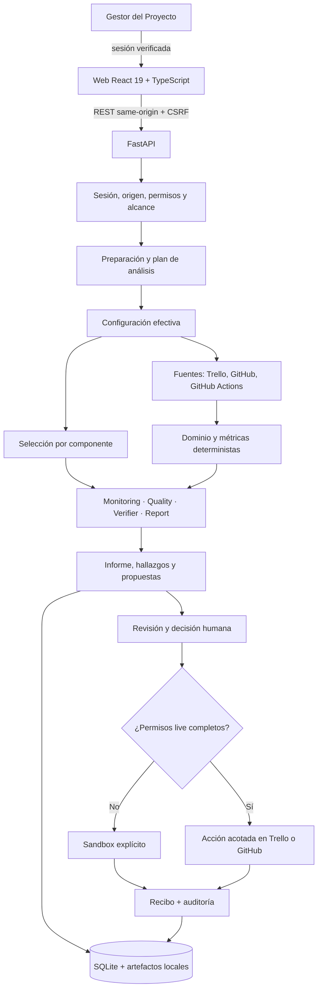

# Arquitectura del sistema actual

El producto es una aplicación local, modular y centrada en el gestor humano. React presenta el trabajo; FastAPI valida sesión, proyecto y consentimiento; servicios de aplicación coordinan el análisis y las acciones; el dominio calcula hechos; adaptadores conectan SQLite y proveedores externos. Los agentes producen análisis y recomendaciones, nunca autoridad de escritura.

## Vista de conjunto

El proceso web usa un worker local acotado para trabajos de análisis. El acceso a la base, el pipeline y los adaptadores se inicia desde el backend; abrir una pantalla de consulta no autoriza por sí solo llamadas remotas ni cambios externos.

## Capas y responsabilidades

| Capa | Ubicación principal | Responsabilidad | Límite de autoridad |
|---|---|---|---|
| Presentación | `frontend/src/app`, `frontend/src/features` | Navegación, formularios, estados y lectura de respuestas REST | No calcula métricas oficiales ni persiste aprobaciones locales. |
| API | `src/agente_gestion/api` | DTOs, rutas, sesión, origen, CSRF, alcance, idempotencia y trabajos web | No confía en actor, rol, proyecto o permiso declarados por el cliente. |
| Aplicación | `src/agente_gestion/application` | Casos de uso de análisis, lectura, revisión, ejecución, notificaciones y programación | Comprueba las condiciones antes de entrar a adaptadores con efectos. |
| Dominio | `src/agente_gestion/domain` | Entidades, estados, reglas, fechas, métricas y políticas deterministas | Valores no observados permanecen desconocidos; la IA no reemplaza las reglas. |
| Puertos | `src/agente_gestion/ports` | Contratos para fuentes, acciones, proveedores y persistencia | Separa el caso de uso de la tecnología concreta. |
| Adaptadores | `src/agente_gestion/adapters` | Trello/GitHub/Actions, Gemini/Groq, SQLite, correo y sandbox | Acceso externo limitado por credenciales, permisos, consentimiento y modo. |
| Persistencia | `SQLiteStorageAdapter`, repositorios API, directorios de artefactos | Capturas, corridas, informes, decisiones, outbox y auditoría | Las proyecciones API omiten secretos y payloads no permitidos. |

## Roles del análisis

| Rol funcional | Implementación | Proveedor predeterminado | Qué produce |
|---|---|---|---|
| Ejecutor | `ProjectMonitoringAgent` | Gemini | Resumen de seguimiento, riesgos y propuestas basados en hechos del backend. |
| Revisor | `CodeQualityAgent` | Groq | Hallazgos candidatos sobre cambios de código y políticas aplicables. |
| Verificador | `VerifierAgent`, si la política requiere corroboración | Gemini | Evaluación independiente; la falta de evidencia no se transforma en confirmación. |
| Síntesis | `ReportAgent` | Gemini | Explicación y recomendaciones sujetas a métricas y reglas calculadas. |
| Coordinación | `ProjectOrchestrator` | Lógica determinista | Selección de etapas, límites, persistencia y consolidación. |
| Aprobación final | Gestor humano autenticado | No aplica | Aceptar, modificar o rechazar una acción con motivo durable. |

El nombre histórico de un rol no confiere privilegios. En particular, `ReportAgent` es consultivo: no aprueba una propuesta, no concede permisos y no habilita escrituras.

## Configuración efectiva

La API y la CLI usan configuración YAML del proyecto, variables de entorno del proceso y valores del archivo `.env` local cuando está habilitado. La precedencia es: argumentos/overrides explícitos → entorno del proceso → `.env` → YAML → defaults. El loader no debe exportar valores del archivo a `os.environ` ni interpolar variables dentro de valores literales.

- `AGENTE_CONFIG_PATH` selecciona el YAML de la API; el valor por defecto es `config/hormigestion.yaml`.
- La CLI acepta `--config`; su YAML predeterminado es `config/config.yaml`.
- `GITHUB_REPO` y `GITHUB_REPOSITORY` son alias de repositorio; `GITHUB_BRANCH` y `GITHUB_REF` son alias de rama. Valores contradictorios deben rechazarse.
- `TRELLO_BOARD_ID` y `board_id` del YAML pueden asociar automáticamente el tablero al proyecto `HORMIGESTION`; `TRELLO_BOARD_IDS` permite el mapa explícito por proyecto.
- `ALLOW_REMOTE_AI` y `EXTERNAL_WRITES_ENABLED` son `true` por defecto en la configuración del producto; `false` explícito sigue siendo efectivo.
- Las claves de proveedores son opcionales para preparar un análisis: cada componente sin credencial usa un fallback local determinista y declara la razón. Los valores de secretos no se devuelven en la API ni en los documentos.

La clave remota configurada no prueba conectividad, cuota, disponibilidad del modelo ni permiso para transferir información. La preparación expone configuración y modo antes de confirmar; no se hace una prueba de red en preflight.

## Selección de proveedores y fallback

La selección es por componente, no un booleano global de éxito:

| Componente | Camino configurado | Sin credencial remota disponible |
|---|---|---|
| Monitoring | Gemini | Fallback determinista local; conservar hechos observados y señalar limitaciones. |
| Quality | Groq | Fallback local acotado; no elevar una sospecha a hallazgo confirmado. |
| Verifier | Gemini, cuando hay criterio de escalamiento | Revisión conservadora local; si la evidencia no alcanza, mantener el estado pendiente o insuficiente. |
| Report | Gemini | Síntesis local determinista desde resultados persistidos; no recalcular ni rellenar datos ausentes. |
| Lectura de fuentes | Trello, GitHub y GitHub Actions en modo real | Fuentes locales/configuradas o sandbox, declarado en la preparación; nunca presentar datos simulados como captura live. |

La preparación declara `ready`/`eligible` cuando puede ejecutar el plan disponible, incluso si uno o más componentes usarán fallback local. `fallback_reasons` identifica qué componente no usará servicio remoto y por qué. Si una fuente necesaria o un dato verificable no existe, se conserva como desconocido; el análisis puede terminar con hallazgos pendientes o recomendación de evidencia insuficiente.

El resultado publica `execution_mode`:

- `live`: los componentes pertinentes usaron los servicios externos autorizados y las acciones remotas confirmaron su resultado.
- `mixed`: algunos componentes usaron servicios autorizados y otros su fallback local o sandbox.
- `sandbox`: la ejecución y las acciones se limitaron a datos y adaptadores locales.

El modo y `fallback_reasons` del análisis son metadatos del trabajo, no un atajo para declarar éxito. El recibo de una acción externa informa el modo y resultado de esa operación. Una escritura live fallida conserva su estado de fallo o incertidumbre; no se vuelve a etiquetar como sandbox exitoso.

## Consentimiento, autenticación y escrituras externas

`ALLOW_REMOTE_AI` habilita la opción de proveedor remoto a nivel servidor, pero el gestor confirma por separado cada análisis que transfiere datos a servicios remotos. La sesión `PROJECT_MANAGER`, el alcance del proyecto, un origen permitido, CSRF y la clave de idempotencia protegen las operaciones. Las rutas de mutación obtienen identidad y permisos de la sesión del servidor, nunca del cuerpo de la petición.

`EXTERNAL_WRITES_ENABLED=true` es el default del producto, pero una escritura live requiere además:

1. proyecto de origen real y vinculado al recurso correcto;
2. credenciales válidas y permiso efectivo del proveedor;
3. decisión humana explícita y motivo;
4. validación previa y posterior del objeto/archivo afectado;
5. clave de idempotencia y recibo auditable.

Si cualquiera de las condiciones para live falta antes de la operación, se selecciona sandbox y se declara. Si la llamada live ya se intentó y falla, el resultado es fallo/estado incierto; no hay fallback que oculte la escritura fallida. Para GitHub, una rama no implica la creación de un Pull Request; para Trello, sandbox no modifica tarjetas.

El destinatario predeterminado de notificaciones es `session.email` de la sesión verificada del gestor. `MANAGER_EMAIL` es la opción del servidor cuando no hay correo de sesión. El envío SMTP exige configuración y confirmación del destinatario; una aceptación del relay no confirma entrega en el buzón.

## Contratos y almacenamiento

- **Análisis:** preparación vinculada a proyecto, sesión, huella de configuración y caducidad; confirmación separada con consentimiento remoto e idempotencia; trabajo en cola y consulta de estado.
- **Hallazgos:** candidato, evidencia y verificación son estados distintos. El backend contrasta rutas, líneas, SHA y fuente completa antes de permitir una decisión de código.
- **Propuestas:** revisión técnica, autorización humana, ejecución y resultado de verificación se registran por separado.
- **Modo:** `execution_mode` y `fallback_reasons` describen el camino realmente tomado por cada componente/operación; no se infieren de que la petición haya sido aceptada.
- **SQLite:** guarda capturas, tareas, corridas, etapas, hallazgos, informes, decisiones, propuestas, ejecuciones, trabajos y auditoría. Los artefactos de informe y outbox son locales.
- **API:** expone proyecciones tipadas y paginadas. Los secretos, rutas arbitrarias y payloads completos de proveedores no forman parte del contrato público.

## Límites de evidencia

El código y las pruebas unitarias controladas pueden demostrar validación local, persistencia e idempotencia; no certifican disponibilidad de Gemini/Groq, permiso real de Trello/GitHub, una mutación remota, entrega de correo ni desempeño general. No se declara cumplimiento porcentual de REQ-01 a REQ-11. La suite backend terminó con 844 pruebas aprobadas y 1 optativa real omitida; el frontend pasó tipos, compilación y 92 pruebas Playwright. La verificación independiente ejecutó 45 pruebas focalizadas sin fallos, incluido el pipeline determinista y su informe persistido mediante HTTP. El alcance, las advertencias y los límites se registran en [INFORME_PRUEBAS.md](INFORME_PRUEBAS.md).

## Referencias de implementación

- [Configuración y precedencia](src/agente_gestion/application/config.py) · [configuración de API](src/agente_gestion/api/settings.py)
- [API y composición](src/agente_gestion/api/app.py) · [rutas](src/agente_gestion/api/routes.py)
- [Análisis](src/agente_gestion/api/analysis_jobs.py) · [Monitoring](src/agente_gestion/agents/monitoring.py) · [Quality](src/agente_gestion/agents/quality.py) · [Report](src/agente_gestion/agents/report.py)
- [Guía del frontend](docs/01-frontend-guia-y-estado.md) · [catálogo REST](docs/02-backend-arquitectura-y-api.md) · [matriz de requisitos](docs/03-motor-de-agentes-y-requisitos.md)
