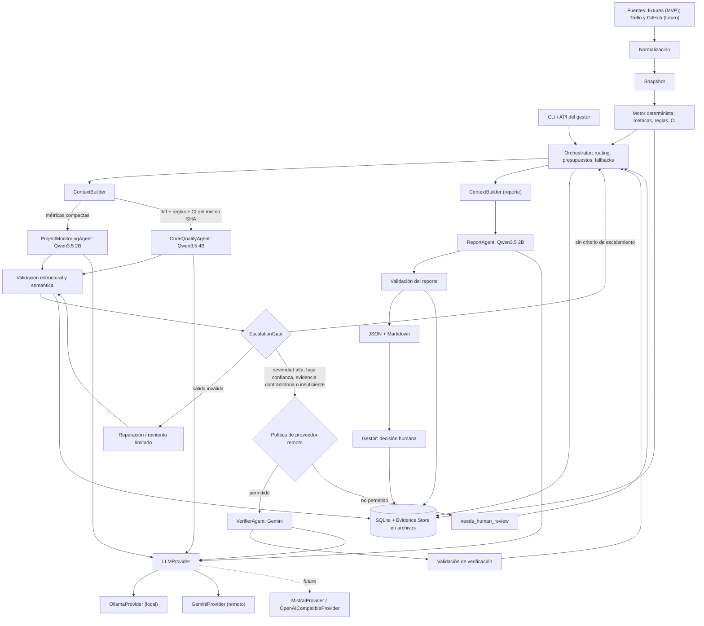

# Arquitectura del Asistente Multiagente para Seguimiento de Proyectos y Aseguramiento de Calidad de Software

Revisión 2 (6 de octubre de 2026). Sustituye a la propuesta del 2 de octubre
(conservada en `ARCHITECTURA.v1.md`). Este documento conserva la **arquitectura
de referencia histórica**. Su plan por fases no equivale al estado del código
actual. Para conocer lo construido al 10 de octubre de 2026, consultar
[arquitectura implementada](docs/arquitectura-implementada.md) y
[validaciones del MVP](docs/mvp-01-validation.md).

## Estado de lo descrito

**Estado actualizado (10/10/2026).** Lo siguiente diferencia lo implementado
de lo que solo se planificó. Los apartados posteriores describen el diseño de
octubre y pueden mencionar etapas históricas como «futuras».

| Etiqueta | Elementos | Alcance de la evidencia |
|---|---|---|
| **Implementado y validado offline** | Orquestador modular, agentes Monitoring/Quality/Verifier/Report, motor determinista, ContextBuilder, EscalationGate, SQLite, CLI, adaptadores Trello/GitHub/Actions y proveedores Ollama/Gemini/Groq/Mistral. | Suite y benchmarks offline; la última implementación híbrida reportó 472 tests y 7 benchmarks aprobados. |
| **Probado con fuentes reales (T8)** | Trello (31 tarjetas), GitHub (6 elementos), GitHub Actions (0 runs) para HORMIGESTION; SHA compartido entre código y Actions. | Conectividad y normalización real verificadas. Cero ejecuciones de CI no equivale a una política aprobada. |
| **Probado parcialmente en E2E (T9)** | Un run real generó informe; luego se observaron errores de contexto y grounding, y un 503 temporal de Gemini. | `needs_attention` documentado, pero aún sin nueva prueba E2E real después del cambio híbrido. |
| **Pendiente** | Validación real Quality=Groq/Mistral, CI con métricas completas, scheduler semanal, notificaciones, multi-repo por proyecto, interfaz y escrituras tras aprobación. | No presentar como implementado o validado. |

El sistema sigue siendo un **monolito modular supervisado y de solo lectura** en
su piloto. `FastAPI`, OAuth, scheduler, panel de gestión y soporte multi-repo
son conceptos de evolución; no se acreditan aquí como funcionalidades listas.

## Objetivo

Apoyar al gestor de un proyecto de software mediante:

- seguimiento de actividades y análisis del avance;
- detección de retrasos, bloqueos y riesgos;
- revisión de calidad del código y análisis de resultados de CI;
- un reporte semanal (idealmente los viernes) con recomendaciones sustentadas
  en evidencia.

Fuentes: Trello, GitHub, GitHub Actions y criterios de calidad configurados
para el proyecto. El sistema es **observador, analista, verificador y
recomendador**. La decisión final pertenece al gestor humano. En el MVP ningún
agente modifica Trello, GitHub ni el código fuente, y ninguno dispone de shell
arbitrario sobre repositorios externos.

Idea que resume el diseño:

> El sistema utiliza componentes deterministas para calcular hechos objetivos y
> modelos de lenguaje especializados para interpretar evidencias y generar
> recomendaciones. Los modelos locales ejecutan las tareas frecuentes y de bajo
> costo, mientras que los casos ambiguos o críticos pueden escalarse a un modelo
> remoto. Los hallazgos relevantes se verifican de forma independiente antes de
> integrarse en el reporte. La decisión final permanece en manos del gestor.

Flujo conceptual, adaptado de principios de sistemas multiagente:
**orquestar → delegar → verificar → consolidar → presentar evidencia → decisión humana.**

## Decisiones conservadas de la arquitectura anterior

| Decisión de v1 | Estado en v2 |
|---|---|
| Backend Python modular, FastAPI, Pydantic, SQLite para el prototipo. | Conservada (monolito modular). |
| El backend calcula hechos; la IA interpreta y redacta. | Conservada y reforzada (motor determinista explícito). |
| Contrato `LLMProvider` con `ModelCapabilities` y estados `complete/incomplete/refused/error`. | Conservada y ampliada con política por rol. |
| `OllamaProvider` nativo `/api/chat` con `format` para el esquema. | Conservada. |
| Uso nulo ≠ cero: un dato no informado queda en `null`. | Conservada. |
| Evidencias con procedencia (repo, PR, SHA, archivo, líneas); CI debe corresponder al mismo SHA. | Conservada y reforzada (Evidence Store). |
| Criterios de calidad con `pass` / `fail` / `unknown`; sin reportes no se inventan valores. | Conservada. |
| Datos externos tratados como no confiables; sin shell ni escritura en Trello/GitHub en el MVP. | Conservada. |
| Credenciales solo en backend; sin envío remoto salvo política explícita del proyecto. | Conservada. |
| Persistencia por etapas con reanudación, idempotencia, `needs_attention`, límite global de llamadas. | Conservada y extendida. |
| Un modelo local activo a la vez en la laptop. | Conservada (restricción de VRAM de 4 GiB). |
| Salida JSON válida no acredita contenido correcto. | Conservada y formalizada en validación semántica. |
| Estructura de directorios `api/ domain/ application/ agents/ ports/ adapters/ quality/ prompts/ worker/`. | Conservada con subpaquetes puntuales. |
| Decisión final del gestor; excepción con motivo conservando el resultado original. | Conservada. |

## Cambios principales de esta revisión

| # | Cambio | Motivo |
|---|---|---|
| 1 | Se elimina la cadena rígida Elaborador → Revisor → Aprobador. Roles: Orchestrator, ProjectMonitoringAgent, CodeQualityAgent, VerifierAgent, ReportAgent. | Separar quien coordina, analiza, produce un hallazgo, verifica y reporta. |
| 2 | Se elimina el "Aprobador IA" como etapa de autoridad; su función pasa a `VerifierAgent` (consultivo, por hallazgo). | La decisión es humana; la verificación es por claim, no por reporte. |
| 3 | Routing condicional en lugar de pipeline fijo. | Reducir llamadas, latencia y tokens. |
| 4 | Principio **local-first, cloud-on-demand** con `EscalationGate`. | Medición local de velocidad/precisión y límites del hardware. |
| 5 | `ContextBuilder` como componente explícito, con contexto distinto por agente. | Cabe en la ventana ≠ se interpreta bien. |
| 6 | Motor determinista como componente de primer nivel. | Errores de conteo, porcentaje y vencimiento en las tres pruebas largas. |
| 7 | Hallazgos y verificaciones como entidades persistentes (`findings`, `verification_results`, `provider_events`). | Trazabilidad y verificación independiente. |
| 8 | Perfil inicial: `OllamaProvider` + `GeminiProvider`; `OpenAIProvider` pasa a extensión. | Prototipo con API gratuita y política de fallback. |
| 9 | Sin razonamiento local pesado; razonamiento complejo solo en modelo remoto. | La prueba con reasoning agotó el presupuesto sin producir JSON. |
| 10 | Primer prototipo: CLI `python -m agente_gestion run` sobre fixtures; sin Trello/GitHub reales, OAuth, scheduler ni dashboard. | Validar el flujo antes de depender de credenciales. |

## Principios de diseño

1. **Hechos deterministas, interpretación con LLM.** Ningún número visible lo calcula un modelo.
2. **Local-first, cloud-on-demand.** Los modelos locales hacen lo frecuente y barato; la nube se usa por criterios formalizados, no por defecto.
3. **Quien genera un hallazgo no lo verifica.** Generador y verificador son agentes distintos (y, para casos críticos, de distinto proveedor).
4. **Un hallazgo es una hipótesis hasta verificarse.** Detectar un defecto no equivale a validar una solución.
5. **Evidence-first.** Cada afirmación referencia evidencia con identificador verificable.
6. **Contexto mínimo suficiente.** Cada agente recibe solo lo que necesita.
7. **Routing por necesidad.** No todos los agentes corren en cada ejecución.
8. **Fronteras estructuradas.** Los agentes se comunican con JSON/Pydantic, no con texto libre extenso.
9. **Límites explícitos.** Presupuestos de llamadas, tokens, reintentos y rondas.
10. **Datos no confiables.** El contenido externo nunca altera instrucciones del sistema.
11. **Humano al final.** El sistema recomienda; el gestor decide.
12. **Monolito modular primero.** Sin microservicios ni infraestructura distribuida innecesaria.

Se adaptan de sistemas multiagente como Gentle AI únicamente: especialización,
delegación, verificación independiente, evidence-first, routing según necesidad,
límites de iteración y trazabilidad. No se adopta su modo de escritura autónoma.

## Evidencia experimental que sustenta el diseño

Fuente: [INFORME_PRUEBAS.md](INFORME_PRUEBAS.md) y `resultados/`. Hardware:
Ryzen 5 6600H, 14,8 GiB de RAM utilizable, RTX 3050 Laptop de 4 GiB, Ollama,
CUDA, modelos Q4_K_M. Cuatro casos simulados, tres repeticiones, temperatura 0,
contexto 4096, máximo 768 tokens de salida, sin razonamiento.

| Modelo | tok/s (mediana) | Respuesta (mediana) | VRAM máx. observada | Campos correctos |
|---|---:|---:|---:|---:|
| Qwen3.5 2B | 95,6 | 1,98 s | 2456 MiB | 45/54 (83,3 %) |
| Qwen3 4B Instruct 2507 | 33,8 | 6,59 s | 2736 MiB | 42/54 (77,8 %) |
| Qwen3.5 4B | 22,7 | 8,21 s | 3065 MiB | 48/54 (88,9 %) |

Con temperatura 0,7 y los parámetros de las fichas de Qwen, Qwen3.5 2B bajó a
38/54 (70,4 %) y Qwen3.5 4B a 43/54 (79,6 %): **no hay configuración ganadora
universal** y el prototipo usará temperatura 0 como punto de partida.

| Observación | Consecuencia de diseño |
|---|---|
| Con 66 tarjetas (≈4,2–4,4 K tokens, contexto 8192) los tres modelos cargaron la entrada pero calcularon mal totales, porcentajes y vencidas (9/18, 9/18 y 6/18). | "Caber en la ventana de contexto ≠ interpretar correctamente todos los datos": motor determinista + contexto compacto. |
| Qwen3.5 4B tardó 48,17 s en la entrada larga (vs 8,21 s en casos cortos). | Entradas grandes se dividen; el 4B no procesa datasets completos. |
| Qwen3.5 4B detectó los tres defectos y sus líneas en las repeticiones cortas. | Candidato razonable como detector local de hallazgos. |
| El mismo modelo propuso una corrección técnicamente incorrecta (gestor de contexto de `sqlite3.Connection` no cierra la conexión). | Detectar ≠ verificar una solución: las sugerencias de código requieren verificación y revisión humana. |
| Qwen3.5 2B afirmó que dividir una lista vacía devolvía cero; los modelos usaron IDs de regla incorrectos. | Validación semántica de IDs y referencias en el backend. |
| Qwen3.5 4B con razonamiento consumió 2048 tokens en ~108 s sin producir el JSON final. | Sin razonamiento local pesado; razonamiento complejo, si hace falta, en modelo remoto. |

Límites de la evidencia: cuatro casos y tres repeticiones orientan el prototipo;
**no permiten estimar la precisión del sistema en proyectos reales**. Cualquier
porcentaje de esta tabla describe solo esa muestra. La puntuación automática
verifica campos y líneas, no la corrección de las explicaciones.

## Arquitectura general

El sistema se organiza como un monolito modular Python. Un **Orchestrator**
ejecuta un flujo con rutas condicionales sobre un snapshot normalizado. El
**motor determinista** calcula hechos; el **ContextBuilder** arma entradas
compactas por agente; los agentes generan salidas estructuradas; un
**EscalationGate** decide si un resultado local basta o requiere verificación
remota; el **ReportAgent** consolida; el gestor decide.

```text
                       ORCHESTRATOR
                            |
        +-------------------+-------------------+
        v                   v                   v
  ProjectMonitoring     CodeQuality          Verifier
      Agent               Agent            (por escalamiento)
        |                   |                   ^
        |                   +--> EscalationGate-+
        +---------+---------+
                  v
              ReportAgent
                  |
                  v
               Gestor
```

## Diagrama Mermaid



Las llamadas a fuentes y proveedores las inicia únicamente el backend. Los
textos recuperados son datos y no pueden cambiar instrucciones ni activar
herramientas.

## Responsabilidad de módulos

| Módulo | Responsabilidad |
|---|---|
| API / CLI | Crear ejecuciones, consultar estado y reportes, registrar decisiones humanas. En el prototipo: CLI. |
| Fuentes (`adapters/sources`) | Leer fixtures (MVP) y, después, Trello/GitHub/Actions con paginación y manejo de errores. |
| Normalización | Convertir fuentes a contratos internos con IDs, fechas, URLs y procedencia. |
| Motor determinista (`quality/`) | Calcular métricas y evaluar reglas objetivas sin LLM. |
| ContextBuilder (`application/context`) | Construir contexto compacto y distinto por agente, con presupuesto de tokens. |
| Orchestrator (`application/orchestrator`) | Controlar flujo, routing, presupuestos, fallbacks, registro de agente/modelo y reanudación. |
| Routing / EscalationGate (`application/routing`) | Reglas de qué agente ejecutar y cuándo escalar. |
| Agentes (`agents/`) | Interpretar, analizar, verificar y redactar con salida estructurada. |
| Validación | Estructural (Pydantic) y semántica (IDs, referencias, reglas, consistencia). |
| Proveedores (`adapters/llm`) | Traducir entre contratos internos y Ollama/Gemini; declarar capacidades. |
| Evidence Store / persistencia | Guardar snapshots, evidencias, hallazgos, verificaciones, reportes, decisiones y llamadas. |
| Gestor humano | Autoridad final. |

## Motor determinista

Calcula, **sin LLM**, y persiste en `metrics.json`:

- total de tareas, terminadas, vencidas y bloqueadas;
- porcentaje de avance;
- diferencias entre snapshots (cuando exista un snapshot previo);
- estado de CI por commit evaluado;
- cobertura y resultados de tests cuando existe un reporte verificable;
- métricas de herramientas (análisis estático, vulnerabilidades) desde reportes existentes;
- evaluación de reglas objetivas con `pass` / `fail` / `unknown`.

Fórmulas y reglas (heredadas de v1):

```text
avance = tareas_terminadas / tareas_incluidas * 100    # sin tarjetas: sin datos (null)
vencida = fecha_límite < fecha_de_corte AND no terminada
```

- Estados de Trello mapeados por ID de lista; un estado sin mapear es `unknown`.
- Datos contradictorios (lista y vencimiento) se señalan, no se resuelven por inferencia.
- Un criterio obligatorio `unknown` impide una recomendación favorable; un criterio `fail` mantiene la recomendación de cambios.
- No se inventan valores cuando faltan reportes.

El LLM **nunca** recibe la instrucción "cuenta estas 66 tarjetas y calcula el
porcentaje". Recibe el resultado, por ejemplo:
`{"total": 66, "completed": 2, "progress": 3.0, "overdue": ["T2","T3"]}`.
Los números visibles del reporte final se insertan desde `metrics.json`.

## ContextBuilder

Componente explícito que produce un `AgentContext` por agente y por trabajo.

Responsabilidades:

- seleccionar solo evidencia relevante a la tarea del agente;
- generar contextos distintos para Monitoring, CodeQuality, Verifier y Report;
- conservar las fuentes completas fuera del prompt, referenciándolas por ID y hash;
- incluir IDs y referencias verificables en cada fragmento;
- dividir cambios grandes por archivo o unidad lógica y consolidar hallazgos por ID;
- reservar tokens de salida dentro de `max_context` del rol;
- **impedir truncamiento silencioso de evidencia crítica**: si no cabe, reducir el lote o marcar la evaluación como `incomplete`;
- rechazar el envío a un proveedor remoto cuando la política del proyecto no lo permite, y aplicar redacción de secretos antes de cualquier envío.

| Agente | Contexto que recibe | No recibe |
|---|---|---|
| ProjectMonitoringAgent | Métricas calculadas, lista de IDs relevantes (vencidas, bloqueadas), deltas respecto al snapshot previo. | Las tarjetas completas ni cálculos pendientes. |
| CodeQualityAgent | `git diff` entre el último snapshot/commit analizado y el actual, fragmentos de archivos relevantes, criterios aplicables, resultados de CI del mismo SHA. | El repositorio completo. |
| VerifierAgent | Claim, evidencia, fragmento relevante, criterio de calidad y CI relacionado. | El razonamiento del agente que generó el hallazgo. |
| ReportAgent | Métricas, hallazgos, verificaciones, tendencias y referencias. | Fuentes crudas; no recalcula nada. |

Flujo para código:

```text
último snapshot/commit analizado → git diff → archivos relevantes → CodeQualityAgent
```

## Orquestador y routing

El **Orchestrator** coordina; no hace el trabajo analítico. Debe:

- controlar el flujo y leer los resultados del motor determinista;
- decidir qué agentes ejecutar y preparar sus trabajos;
- controlar presupuestos (tokens y llamadas) y reintentos;
- manejar fallbacks de proveedor;
- registrar qué agente, proveedor y modelo produjo cada resultado;
- decidir si un hallazgo requiere verificación externa (mediante `EscalationGate`);
- coordinar la generación final del reporte;
- evitar enviar contexto innecesario a los LLM.

### Routing condicional

No hay un pipeline fijo `monitor → quality → verifier → report`.

```text
snapshot
  → motor determinista
  → ¿hay actividad de seguimiento (tareas, cambios, vencimientos)?  sí → ProjectMonitoringAgent
  → ¿hay cambios de código en el período?                            sí → CodeQualityAgent
  → ¿algún hallazgo cumple un criterio de escalamiento?              sí → VerifierAgent
  → cuando todos los resultados requeridos estén disponibles          → ReportAgent
```

| Condición evaluada por el backend | Agente | Si no se cumple |
|---|---|---|
| Tareas con actividad, vencimientos o bloqueos | ProjectMonitoringAgent | Se omite; el reporte usa solo métricas. |
| Diff no vacío con archivos analizables | CodeQualityAgent | Se omite; el reporte indica "sin cambios de código". |
| Hallazgo con `requires_verification` (ver EscalationGate) | VerifierAgent | Se omite; el hallazgo se marca `unverified_local`. |
| Resultados requeridos disponibles | ReportAgent | Se espera; si faltan por error, ejecución `needs_attention`. |

Cada decisión de routing se persiste con su motivo en `stage_results`.

## Agentes y responsabilidades

| Agente | Modelo inicial propuesto | Entrada | Salida |
|---|---|---|---|
| **Orchestrator** (no LLM en el prototipo) | — | Estado de la ejecución, métricas, política. | Plan de etapas, trabajos, decisiones de routing. |
| **ProjectMonitoringAgent** | Qwen3.5 2B local (Ollama) | Métricas ya calculadas y referencias. | `MonitoringAnalysis`: interpretación de avance, desviaciones, riesgos, tendencias. |
| **CodeQualityAgent** | Qwen3.5 4B local (Ollama), sin razonamiento | Diff, fragmentos, criterios, CI del mismo SHA. | Lista de `Finding` **candidatos**. |
| **VerifierAgent** | Gemini (API gratuita) | Claim, evidencia, fragmento, criterio, CI. | `VerificationResult`. |
| **ReportAgent** | Qwen3.5 2B local | Métricas, hallazgos, verificaciones, tendencias, referencias. | `Report` estructurado y Markdown. |
| **Gestor humano** | — | Reporte y evidencias. | `HumanDecision`: aprobar, solicitar cambios, posponer, aceptar excepción con justificación. |

Reglas:

- **ProjectMonitoringAgent** interpreta; **no calcula** ninguna métrica.
- **CodeQualityAgent** produce hallazgos candidatos. Sus conclusiones no son hechos. Las correcciones sugeridas se marcan como no verificadas.
- **VerifierAgent** devuelve `confirmed`, `rejected`, `insufficient_evidence` o `needs_human_review`, con las evidencias usadas. No se ejecuta para todo. Verifica claims; no certifica soluciones propuestas.
- **ReportAgent** usa exclusivamente métricas deterministas, hallazgos, verificaciones, tendencias y referencias; no inventa ni recalcula valores.
- No existe un "Aprobador IA". El `VerifierAgent` no emite aprobación de reporte ni de PR. Un criterio objetivo incumplido sigue siendo decidido por el motor de reglas.

Las asignaciones de modelo son configuración inicial derivada de una muestra
limitada; se revalidan con casos propios del dominio.

## Flujo completo de una ejecución

1. Crear una ejecución (`run_id`) con proyecto, período, fecha de corte y versiones de política/prompts/configuración.
2. Cargar fuentes (fixtures en el prototipo) y guardar el **snapshot** con su estado de completitud.
3. Normalizar tareas, cambios de código y resultados de CI.
4. **Motor determinista**: métricas y evaluación de reglas.
5. **Orchestrator** decide el routing según los resultados.
6. **ContextBuilder** genera contextos; **ProjectMonitoringAgent** (si aplica) produce `monitoring.json`.
7. **CodeQualityAgent** (si hay cambios de código) produce hallazgos candidatos por unidad lógica; el backend consolida por ID.
8. **Validación** estructural y semántica de cada salida; reparación limitada si es inválida.
9. **EscalationGate** evalúa cada hallazgo y decide si requiere verificación.
10. **VerifierAgent** (solo si se escala y la política lo permite) devuelve verificaciones validadas.
11. El Orchestrator consolida y el **ReportAgent** redacta usando solo datos validados.
12. **Validación del reporte**: IDs, referencias, números contra `metrics.json`.
13. Generar JSON y Markdown; estado `awaiting_human`.
14. El gestor registra su decisión sobre una versión concreta del reporte.

Un dato crítico ausente, una referencia inexistente o una respuesta incompleta
impiden marcar el reporte como listo para decidir (`needs_attention`).

## Escalamiento local → cloud

```text
Qwen local → resultado candidato → validación → EscalationGate
   ├─ sin criterio de escalamiento ........ continuar local
   ├─ salida inválida ..................... reparación / reintento (limitado)
   └─ alguno de los criterios siguientes .. VerifierAgent (Gemini), si la política lo permite
```

Formalización inicial (la fórmula exacta es ajustable):

```text
ESCALATE =
      high_severity
   OR low_confidence
   OR conflicting_evidence
   OR insufficient_evidence
   OR local_validation_failed      # tras agotar la reparación local
```

| Criterio | Definición operativa propuesta |
|---|---|
| `high_severity` | `severity` ∈ {`high`, `critical`}, o la regla afectada es obligatoria y de seguridad. |
| `low_confidence` | `confidence` < umbral configurable (valor inicial a calibrar). La confianza declarada por un modelo pequeño **no está calibrada**; se usa como señal auxiliar junto con otras. |
| `conflicting_evidence` | El hallazgo contradice el CI del mismo SHA, otro hallazgo, o una regla evaluada. |
| `insufficient_evidence` | Faltan fragmento, líneas, CI del SHA o regla asociada. |
| `local_validation_failed` | Salida inválida tras el reintento o IDs/referencias inexistentes. |

Salidas posibles del gate: `continue_local`, `repair_retry`, `verify_remote`,
`needs_human_review`. El gate está en el backend (código determinista), no en un
LLM, y registra qué criterios se activaron.

Presupuesto: un máximo de verificaciones remotas por ejecución
(`max_remote_verifications`); los hallazgos sobrantes se ordenan por severidad y
los no verificados quedan marcados `unverified`.

### Política de proveedor y fallback

```text
Gemini → (cuota / error) → [futuro] Mistral → (error) → resultado marcado needs_attention
```

- Solo se cae a otro proveedor si la política del proyecto lo permite explícitamente (`allowed_providers`, `allow_remote_ai`).
- Si Ollama falla, el sistema **no** envía datos automáticamente a un proveedor remoto.
- Si no hay proveedor permitido o disponible, el hallazgo queda `needs_human_review` y la ejecución puede terminar en `needs_attention`.
- Cada envío remoto se registra en `provider_events` (qué datos y a qué proveedor).

Un verificador de otra familia de modelo reduce el riesgo de correlación de
errores con el generador, pero no lo elimina.

## Contratos JSON/Pydantic

Frontera entre agentes: modelos Pydantic serializables a JSON; no hay texto
libre extenso entre agentes. Esquemas representativos:

```json
{
  "id": "CQ-004",
  "type": "security",
  "severity": "high",
  "claim": "...",
  "evidence_ids": ["EV-100", "CI-42"],
  "rule_id": "SEC-04",
  "confidence": 0.76,
  "requires_verification": true,
  "produced_by": {"agent": "CodeQualityAgent", "provider": "ollama", "model": "qwen3.5:4b-q4_K_M"}
}
```

```json
{
  "finding_id": "CQ-004",
  "verdict": "confirmed",
  "evidence_ids": ["EV-100", "CI-42"],
  "explanation": "...",
  "provider": "gemini",
  "model": "..."
}
```

`verdict` ∈ `confirmed | rejected | insufficient_evidence | needs_human_review`.
`type` ∈ `security | defect | maintainability | quality_policy | ci` (ampliable).
`severity` ∈ `low | medium | high | critical`.

Contratos principales: `Snapshot`, `Evidence`, `Metrics`, `RuleResult`,
`AgentContext`, `MonitoringAnalysis`, `Finding`, `VerificationResult`,
`EscalationDecision`, `Report`, `HumanDecision`, `GenerationRequest`,
`GenerationResult`, `ModelCapabilities`.

### Validación en dos capas

Un JSON válido **no** significa contenido correcto. Tras el parseo estructural
el backend valida:

- que todos los `evidence_ids` y `finding_id` existan;
- que `rule_id` exista en la política vigente;
- que archivo y líneas existan en el diff entregado;
- que la evidencia pertenezca al mismo SHA que el hallazgo;
- que los campos requeridos estén presentes y los enums sean válidos;
- consistencia entre `verdict`, evidencias y reglas objetivas;
- que los números del reporte coincidan con `metrics.json`.

Fallar la validación semántica activa reparación (un intento) y luego el
criterio `local_validation_failed`. Ninguna validación certifica la corrección
técnica de una explicación; por eso persiste la revisión humana.

## Proveedores LLM

Se mantiene la abstracción `LLMProvider` con `generate(request) -> result`.

```python
class LLMProvider(Protocol):
    def capabilities(self, model: str) -> ModelCapabilities: ...
    def generate(self, request: GenerationRequest) -> GenerationResult: ...
```

`ModelCapabilities`: `provider`, `model`, `context_limit`, `max_output`,
`structured_output`, `reasoning`, `tool_support`.

`GenerationResult.status`: `complete | incomplete | refused | error`. Uso de
tokens o costo no informados quedan en `null`.

| Adaptador | Etapa | Notas |
|---|---|---|
| `OllamaProvider` | Prototipo | API nativa `/api/chat`, `format` con esquema, `think: false`. |
| `GeminiProvider` | Prototipo | API nativa con salida estructurada; verificar disponibilidad en el modelo elegido y los límites de cuota vigentes. |
| `GroqProvider` | Implementado offline desde 2026-10-07 | CodeQualityAgent configurable por CLI/Settings; la primera validación API real continúa pendiente. |
| `MistralProvider` | Implementado offline desde 2026-10-07 | Proveedor remoto alternativo configurable para CodeQualityAgent; no se afirma fallback automático. |
| `OpenAICompatibleProvider` | Futuro | URL base configurable; comprobar capacidades por modelo. |
| `OpenAIProvider`, `AnthropicProvider` | Futuro | Según necesidad. |

Referencias: [salida estructurada de Ollama](https://docs.ollama.com/capabilities/structured-outputs),
[salida estructurada de Gemini](https://ai.google.dev/gemini-api/docs/structured-output).
Las cuotas y condiciones de uso de la API gratuita cambian y deben consultarse
al implementar; además, conviene revisar si los términos del nivel gratuito
permiten enviar datos del proyecto, ya que esto afecta a la política de datos.

### Configuración por rol (ejemplo histórico de diseño)

El YAML siguiente ilustra la propuesta original y **no es una plantilla
literal validada para el Settings actual**. La implementación real ya lee
`QUALITY_PROVIDER=ollama|groq|mistral` y admite
`--quality-provider`; ver el [README](README.md) y `.env.example`.
No asumir que `allowed_providers` o `remote_data_policy` mostrados aquí
están implementados íntegramente solo por figurar en este ejemplo.

```yaml
project:
  id: proyecto-demo
  timezone: America/Guayaquil
  allow_remote_ai: true          # explícito; false por defecto
  allowed_providers: [gemini]    # sin proveedores no listados, ni como fallback
  remote_data_policy:
    allowed_data: [diff_snippets, rule_ids, ci_summary]
    redact_secrets: true

execution:
  max_concurrent_runs: 1
  max_local_requests: 1
  max_llm_calls_per_run: 10
  max_remote_verifications: 5
  max_repair_attempts: 1

providers:
  ollama:
    adapter: ollama
    base_url: http://127.0.0.1:11435
  gemini:
    adapter: gemini
    api_key_env: GEMINI_API_KEY
    model_env: GEMINI_MODEL

agents:
  monitoring:
    provider: ollama
    model: qwen3.5:2b-q4_K_M
    max_context: 4096
    max_output: 768
    timeout: 60
    max_retries: 1
    thinking: false
    escalation_policy: none
  code_quality:
    provider: ollama
    model: qwen3.5:4b-q4_K_M
    max_context: 4096
    max_output: 768
    timeout: 90
    max_retries: 1
    thinking: false
    escalation_policy: default
  verifier:
    provider: gemini
    model_env: GEMINI_MODEL
    max_context: 8192
    max_output: 1024
    timeout: 60
    max_retries: 2
    fallback: [needs_attention]   # futuro: [mistral, needs_attention]
  report:
    provider: ollama
    model: qwen3.5:2b-q4_K_M
    max_context: 4096
    max_output: 1024
    timeout: 60
    max_retries: 1
    thinking: false
    escalation_policy: none

escalation_policy:
  default:
    high_severity: [high, critical]
    min_confidence: 0.6        # valor inicial sin calibrar
    on_conflicting_evidence: verify
    on_insufficient_evidence: verify
    on_local_validation_failed: verify
```

Los modelos locales se ejecutan por turnos con un único modelo cargado en una
GPU de 4 GiB. Cambiar de 2B a 4B implica carga/descarga; el Orchestrator agrupa
llamadas por modelo para minimizar cambios.

## Evidencias y trazabilidad

Cada hallazgo referencia evidencia verificable:

```json
{
  "evidence_id": "EV-100",
  "source": "github",
  "repository": "org/repo",
  "commit_sha": "abc123...",
  "file": "src/auth.py",
  "lines": "80-91",
  "diff_side": "new",
  "rule_id": "SEC-04",
  "content_hash": "sha256:..."
}
```

Reglas:

- Las evidencias de código conservan repositorio, commit SHA, archivo, lado del diff y líneas.
- **El CI debe corresponder al mismo SHA evaluado.** Un resultado de otro commit no acredita el cambio actual y se descarta como evidencia.
- La vinculación tarea↔PR requiere referencias explícitas; una asociación inferida se marca como tal.
- Los archivos grandes se guardan fuera de la base con ruta y hash; el prompt solo contiene fragmentos con ID.
- Un reporte es reproducible: referencia snapshot, versiones de política, prompts, esquemas, configuración de proveedores, y qué agente/modelo produjo cada resultado.
- Se conservan motivos breves y evidencias, no el razonamiento interno del modelo.

## Persistencia

SQLite (prototipo) más archivos de evidencia con hash.

| Tabla | Contenido |
|---|---|
| `projects` | Proyecto y configuración. |
| `policy_versions` | Versiones de política de calidad y de proveedores. |
| `snapshots` | Corte de datos con estado de completitud. |
| `evidence` | Evidencias con procedencia. |
| `runs` | Ejecuciones, estado, versiones y claves de idempotencia. |
| `stage_results` | Resultado, entrada-hash y routing de cada etapa. |
| `findings` | Hallazgos candidatos con agente/modelo. |
| `verification_results` | Verificaciones y evidencias usadas. |
| `llm_calls` | Proveedor, modelo, prompt-hash, latencia, tokens (si se informan), estado, errores, reintentos, fallback. |
| `provider_events` | Envíos a proveedores, políticas aplicadas, fallbacks y errores de cuota. |
| `reports` | Versiones de reporte JSON/Markdown. |
| `human_decisions` | Decisión, justificación, excepciones y versión revisada. |

Estados de ejecución: `queued`, `collecting`, `analyzing`, `awaiting_human`,
`completed`, `needs_attention`, `failed`, `cancelled`.

### Reanudación e idempotencia

Cada etapa persiste su resultado. Una ejecución interrumpida reanuda desde la
última etapa válida. **No se repite una llamada LLM con resultado válido** si no
cambió su clave:

```text
idempotency_key = hash(snapshot_id, config_version, policy_version,
                       prompt_version, schema_version, agent, provider, model,
                       context_hash)
```

Cambiar evidencia, política, prompt o modelo crea una nueva versión de la
etapa afectada y de las posteriores. Cada intento, incluso fallido, cuenta para
el máximo global de llamadas.

Un único worker reclama trabajos de SQLite mediante una transacción y un
`lease`. Las llamadas de red ocurren fuera de transacciones. Un snapshot
semanal solo describe un corte; las tendencias requieren snapshots previos.

## Seguridad

- Credenciales solo en el backend, vía variables de entorno; nunca en prompts, logs ni frontend.
- Redacción de secretos y exclusión de archivos sensibles antes de cualquier envío remoto.
- Trello, comentarios, descripciones y código son **datos no confiables**; no alteran instrucciones del sistema. El contenido se delimita y etiqueta en el prompt como dato.
- Sin shell arbitrario para los agentes; sin escritura en Trello ni GitHub; sin ejecución de código del repositorio (requeriría aislamiento).
- Sin envío a proveedores externos sin política explícita del proyecto; cada envío queda en `provider_events`.
- Las llamadas a herramientas, si se agregan, están en una lista permitida de solo lectura.
- Interfaz local en loopback; exponerla en red requiere autenticación y autorización.
- La salida del modelo se trata como no confiable: se valida antes de usarla, y no se interpreta como instrucción.

Esto reduce ciertos riesgos; no elimina la posibilidad de inyección indirecta,
por lo que se prueban casos adversarios (ver pruebas).

## Gestión de errores y fallbacks

| Situación | Tratamiento |
|---|---|
| Salida JSON inválida o truncada (`incomplete`) | Un intento de reparación con el mismo contexto; luego `local_validation_failed`. |
| Referencia o ID inexistente | Rechazo semántico; reparación; si persiste, hallazgo descartado o escalado. |
| Error transitorio de proveedor | Reintentos limitados con espera. |
| Autenticación, parámetros o presupuesto | Se detiene la etapa; sin reintentos. |
| Cuota/error de Gemini | Fallback permitido por política (futuro: Mistral); si no, `needs_attention` / `needs_human_review`. |
| Ollama no disponible | No se envía automáticamente a una API remota; `needs_attention`. |
| Fuente parcial | Snapshot con `completeness` parcial; las métricas se marcan y no se presenta como completo. |
| Rechazo del modelo (`refused`) | Registrar y tratar como evidencia insuficiente. |
| Presupuesto de llamadas agotado | Detener, marcar pendientes y generar reporte parcial o `needs_attention`. |
| Reanudación | Reutilizar etapas válidas por clave de idempotencia. |

Los valores no informados (tokens, costo) quedan en `null`; las estimaciones de
costo solo se calculan con tarifas configuradas y se etiquetan como estimación.

## Observabilidad, tokens y latencia

`execution_metrics.json` y `llm_calls` registran:

- latencia por etapa y por llamada;
- proveedor y modelo por llamada;
- tokens de entrada y salida cuando el proveedor los informa;
- reintentos, reparaciones, fallbacks y errores;
- truncamientos y fallos de validación;
- número de llamadas locales y remotas, y causa de cada escalamiento;
- agentes omitidos por routing y su motivo.

Con los resultados medidos como referencia (no garantías): una llamada corta del
2B tardó ≈2 s y una del 4B ≈8 s en esta laptop; la entrada larga del 4B tardó
≈48 s. El diseño reduce latencia limitando contexto, omitiendo agentes y
evitando razonamiento local. Estas cifras deben re-medirse con el flujo real.

## Estructura de código

```text
AgenteGestionProyectos/
├── ARCHITECTURA.md
├── ARCHITECTURA.v1.md
├── README.md
├── INFORME_PRUEBAS.md
├── pruebas/                      # Banco de evaluación existente
├── fixtures/                     # trello.json, github.json, ci.json, quality_policy.json
├── src/agente_gestion/
│   ├── api/                      # Rutas FastAPI (después de la CLI)
│   ├── cli.py                    # python -m agente_gestion run <proyecto>
│   ├── domain/
│   │   ├── findings/             # Finding, severidad, tipos
│   │   ├── evidence/             # Evidence, referencias, SHA
│   │   ├── verification/         # VerificationResult, veredictos
│   │   └── ...                   # tareas, políticas, reportes
│   ├── application/
│   │   ├── orchestrator/         # Flujo, presupuestos, reanudación
│   │   ├── routing/              # Reglas de routing y EscalationGate
│   │   └── context/              # ContextBuilder
│   ├── agents/                   # Monitoring, CodeQuality, Verifier, Report
│   ├── ports/                    # LLMProvider, fuentes, almacenamiento
│   ├── adapters/
│   │   ├── llm/                  # OllamaProvider, GeminiProvider, (futuros)
│   │   ├── sources/              # fixtures (MVP); Trello/GitHub (futuro)
│   │   └── storage/              # SQLite y archivos
│   ├── quality/                  # Motor determinista, parsers de CI
│   ├── prompts/                  # Instrucciones versionadas por agente
│   └── worker/                   # Trabajos persistentes, scheduler (futuro)
├── config/                       # Ejemplos sin credenciales
└── tests/
```

Los subpaquetes `orchestrator`, `routing`, `context`, `findings`, `evidence` y
`verification` se justifican por responsabilidades distintas; si alguno queda
con pocos archivos, puede fusionarse al empezar. Solo existen documentación y
`pruebas/`; el resto es propuesta.

## Arquitectura del primer prototipo (histórico)

El alcance original era solo fixtures. **Hoy** ya existen conectores reales
Trello/GitHub/Actions y proveedores Quality Groq/Mistral. Siguen pendientes
scheduler y dashboard; se conserva el flujo original para trazabilidad.

Entrada:

```text
fixtures/
  trello.json
  github.json
  ci.json
  quality_policy.json
```

Flujo:

```text
fixtures → normalización → motor determinista → ContextBuilder
  → MonitoringAgent (Qwen3.5 2B)
  → CodeQualityAgent (Qwen3.5 4B)
  → EscalationGate
  → VerifierAgent (Gemini, solo si se escala)
  → ReportAgent (Qwen3.5 2B)
  → validación → JSON + Markdown
```

Salida:

```text
runs/<run_id>/
  snapshot.json
  metrics.json
  monitoring.json
  code_findings.json
  verification.json
  report.json
  report.md
  execution_metrics.json
```

Comando objetivo: `python -m agente_gestion run proyecto-demo`.

Criterios de aceptación del prototipo:

- ejecución reproducible completa sobre fixtures;
- métricas idénticas a las esperadas de forma determinista;
- reanudación sin repetir llamadas válidas;
- escalamiento activado y no activado en fixtures distintos;
- verificación omitida cuando no hay criterios de escalamiento;
- sin envío remoto cuando `allow_remote_ai` es falso;
- trazabilidad completa de agente/modelo/proveedor por resultado.

## Orden de implementación

1. **Dominio y fixtures:** modelos Pydantic, fixtures, normalización.
2. **Motor determinista:** métricas, reglas, vinculación CI↔SHA, con pruebas unitarias (incluidas las 66 tarjetas).
3. **Persistencia:** SQLite, Evidence Store, `stage_results`, idempotencia.
4. **Proveedores:** `OllamaProvider` y `GeminiProvider` tras `LLMProvider`; capacidades.
5. **ContextBuilder** y validación estructural/semántica.
6. **Agentes:** Monitoring, CodeQuality, Report; prompts versionados.
7. **EscalationGate, VerifierAgent y política de proveedor.**
8. **Orchestrator y routing condicional**, reanudación y presupuestos.
9. **CLI y salida** (`runs/<run_id>/`).
10. **Evaluación del flujo completo** con los casos del banco y casos nuevos.

Fase 2: Trello, GitHub, Actions, paginación, parsers de CI. Fase 3: historial,
comparación de snapshots, reporte semanal, scheduler, UI sencilla. Fase 4:
múltiples proyectos, proveedores adicionales, mejores políticas de routing,
dashboard, despliegue permanente.

## Estrategia de pruebas

- **Unitarias del dominio y motor:** conteos, porcentajes (sin tarjetas → `null`), vencimientos en la fecha de corte, tarjetas desconocidas, listas contradictorias.
- **Contratos:** esquemas Pydantic, enums y validación semántica (IDs, líneas, SHA).
- **ContextBuilder:** presupuesto de tokens, no truncamiento silencioso, división por archivo.
- **EscalationGate:** tabla de casos por criterio; sin escalamiento cuando no corresponde.
- **Proveedores:** dobles de prueba para Ollama/Gemini; salida truncada, rechazo, cuota agotada, timeout.
- **Routing:** sin cambios de código no se invoca CodeQuality; sin escalamiento no se invoca Verifier.
- **Reanudación:** interrupción en cada etapa; sin llamadas duplicadas.
- **Seguridad:** instrucciones maliciosas en tarjetas y código, secretos en diffs, política que bloquea envío remoto, CI de otro SHA.
- **Agentes con modelos reales:** repetir el banco de pruebas sobre el flujo completo; comparar con revisión manual. No se reporta una precisión general a partir de pocas muestras.
- **Revisión manual de hallazgos y correcciones**, dado que el informe mostró soluciones incorrectas con detección correcta.

## Limitaciones conocidas

- La versión original solo implementaba el banco de pruebas. Ahora existe el
  MVP modular con conectores y agentes; **T9 híbrido en vivo aún no está validado**.
- Muestra experimental pequeña (cuatro casos, tres repeticiones); no sustenta porcentajes de precisión en proyectos reales.
- Los modelos locales de 2B/4B cometen errores aritméticos y de interpretación; el diseño los mitiga con cálculo determinista pero no los elimina.
- La verificación independiente aumenta la confianza, pero un verificador remoto también puede equivocarse o coincidir con el error del generador.
- La confianza declarada por los modelos no está calibrada.
- Los umbrales de escalamiento y los criterios simulados en `pruebas/casos.json` no son una norma adoptada.
- La API gratuita de Gemini tiene cuotas, disponibilidad y términos de datos variables; puede no ser adecuada para código privado.
- GPU de 4 GiB: un modelo local a la vez; el cambio 2B↔4B añade latencia de carga.
- Contextos largos con 4B degradan latencia (≈48 s en la prueba de 66 tarjetas).
- El scheduler semanal no funciona con la laptop apagada; la ejecución permanente requeriría un host disponible.
- No se ejecuta código del repositorio; los resultados dependen de reportes de CI existentes y de parsers por formato.
- No hay evaluación de hallazgos falsos negativos: lo que ningún modelo detecta no se reporta.

## Trabajo futuro

- Ampliar conectores reales Trello/GitHub/Actions ya implementados con historial
  comparativo, métricas CI verificables y, posteriormente, soporte multi-repo.
- Historial, comparación entre snapshots, tendencias y reporte semanal automático.
- Scheduler, UI sencilla y luego dashboard.
- `OpenAICompatibleProvider` u otros proveedores si se justifican; los adapters
  `GroqProvider` y `MistralProvider` ya existen, pero falta verificar sus
  APIs reales y una eventual política de fallback automático.
- Calibración de umbrales de escalamiento con datos propios.
- Evaluación comparativa de modelos locales y remotos con más casos y proyectos reales.
- Múltiples proyectos, autenticación y almacenamiento/cola escalables si hay varios usuarios.
- Despliegue permanente en un equipo siempre disponible.
- Ejecución aislada (sandbox) para análisis dinámico, solo si se justifica y con control de seguridad.
