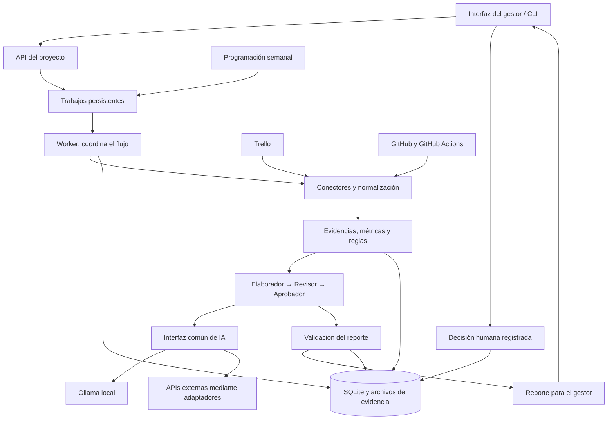

# Arquitectura propuesta del agente de gestión de proyectos

Propuesta del 2 de octubre de 2026. Define el diseño para discutir e implementar;
los conectores, agentes y proveedores remotos todavía no están implementados.
Actualmente el proyecto contiene el banco de pruebas de Ollama y sus resultados.

## Objetivo y decisiones principales

El sistema reúne actividades de Trello, cambios de GitHub y resultados de calidad,
produce un reporte semanal y propone acciones para el gestor. El reporte se
prepara los viernes y el gestor toma decisiones el lunes. La hora del viernes y
el período exacto del reporte serán configurables en `America/Guayaquil`.

Propongo un backend Python organizado en módulos, con FastAPI, contratos
Pydantic y SQLite para el prototipo. Un worker ejecuta el flujo y guarda cada
etapa. Los roles utilizan una interfaz de IA común, con adaptadores para Ollama
y APIs externas. Este diseño permite cambiar de proveedor por configuración.

Las pruebas locales mostraron errores al contar tarjetas, calcular porcentajes
y evaluar fechas. Por ello, el backend calcula y verifica esos hechos; la IA
redacta, interpreta y propone acciones con referencias a las evidencias.
El gestor conserva la decisión final.

## Diagrama de componentes



Las flechas muestran el recorrido principal de los datos. Las llamadas a Trello,
GitHub y los modelos son iniciadas por el backend. Los textos recuperados se
tratan como datos y no pueden cambiar las instrucciones ni activar herramientas.

## Responsabilidad de cada módulo

| Módulo | Responsabilidad |
|---|---|
| API e interfaz | Configurar proyectos, solicitar reportes, ver avances e historial y registrar decisiones. |
| Conectores | Leer Trello, PRs, archivos modificados y resultados de GitHub Actions; gestionar paginación y errores. |
| Normalización | Convertir las fuentes a contratos internos, conservando IDs, fechas, URLs y procedencia. |
| Métricas y políticas | Calcular avance, vencimientos y bloqueos; evaluar criterios de calidad configurados. |
| Preparación de contexto | Seleccionar evidencias por rol y dividir entradas grandes dentro del presupuesto de tokens. |
| Orquestador | Ordenar etapas, persistir resultados, limitar intentos y reanudar ejecuciones. |
| Roles de IA | Elaborar el reporte, revisar hallazgos y explicar una recomendación basada en las políticas. |
| Proveedores de IA | Traducir solicitudes y respuestas entre los contratos internos y cada API. |
| Persistencia y reportes | Conservar snapshots, versiones, métricas de ejecución, reportes y decisiones. |

## Flujo de una ejecución

1. Crear un trabajo con proyecto, período, fecha de corte y versiones de configuración.
2. Consultar las fuentes y guardar un snapshot con estado de completitud.
3. Normalizar tareas, cambios de código y resultados de CI.
4. Calcular métricas y evaluar políticas sobre el snapshot.
5. Preparar evidencias acotadas para el elaborador y obtener su borrador.
6. Ejecutar el revisor sobre el borrador, las evidencias y los cambios relevantes.
7. Permitir una ronda de corrección si el revisor encuentra problemas resolubles.
8. Revalidar el reporte y ejecutar el aprobador sobre las políticas y evidencias.
9. Generar JSON y una vista HTML/Markdown; dejar la decisión pendiente del gestor.
10. Registrar la decisión humana junto con la versión del reporte revisada.

Cada salida de IA se valida antes de pasar a la siguiente etapa. Los números
visibles se insertan desde las métricas calculadas. Una referencia inexistente,
un dato crítico ausente o una respuesta incompleta impiden marcar el reporte
como listo para decidir.

### Roles

| Rol | Entrada | Salida |
|---|---|---|
| Elaborador | Métricas verificadas, cambios de la semana y evidencias relevantes. | Borrador con resumen, riesgos y acciones sugeridas. |
| Revisor | Borrador, criterios, evidencias y fragmentos de código con ubicación. | Hallazgos, inconsistencias y correcciones propuestas con referencias. |
| Aprobador | Reporte corregido y evaluación de políticas realizada por el backend. | Explicación de la recomendación: favorable, requiere cambios o evidencia insuficiente. |
| Gestor | Reporte y sus evidencias. | Decisión final: aprobar, solicitar cambios o posponer. |

El aprobador es un rol asesor: no cambia el resultado de las reglas objetivas.
Un criterio incumplido mantiene la recomendación de cambios; un criterio
obligatorio desconocido impide una recomendación favorable. El gestor puede
registrar una excepción con motivo, conservando el resultado original.

Los tres roles son etapas lógicas. En la laptop se ejecutan por turnos, con una
sola solicitud local activa y un modelo cargado a la vez. Se puede compartir el
mismo modelo entre roles o asignar otro proveedor al revisor.

## Compatibilidad con APIs de IA

El núcleo conoce el contrato `LLMProvider`, no los SDKs ni los campos HTTP de los
proveedores. Cada adaptador implementa `generate(request) -> result` y anuncia
las capacidades del modelo configurado.

### Contrato común

| Objeto | Campos principales |
|---|---|
| `GenerationRequest` | Rol, instrucciones, evidencias, esquema de salida, modelo, presupuesto de generación, timeout y opciones soportadas. |
| `GenerationResult` | Datos estructurados, estado, motivo de finalización, proveedor/modelo, duración, uso de tokens disponible y referencia de solicitud. |
| `ModelCapabilities` | Límite de contexto, límite de salida, soporte de JSON Schema, streaming, herramientas y opciones de razonamiento. |

Los estados de generación distinguen `complete`, `incomplete`, `refused` y
`error`. Un campo de uso o costo no informado queda en `null`; no se registra
como cero. El esquema usa un subconjunto sencillo de JSON Schema y el backend
aplica las restricciones de negocio restantes.

### Adaptadores previstos

| Adaptador | Integración propuesta | Etapa |
|---|---|---|
| `OllamaProvider` | API nativa `/api/chat`; `format` para el esquema y opciones locales. | MVP |
| `OpenAIProvider` | Responses API y `text.format` para modelos que admitan salida estructurada. | MVP |
| `OpenAICompatibleProvider` | Chat Completions con URL base configurable; comprobar capacidades del servicio/modelo concreto. | Extensión |
| `GeminiProvider` | API nativa de Gemini y su soporte de salida estructurada. | Extensión |
| `AnthropicProvider` | Messages API y `output_config.format` en modelos compatibles. | Extensión |

OpenAI recomienda Responses para nuevos proyectos. Ollama ofrece compatibilidad
parcial con APIs de OpenAI, pero mantener su adaptador nativo permite controlar
las opciones locales sin asumir que todas las funciones son equivalentes.
Fuentes: [OpenAI Responses](https://developers.openai.com/api/docs/guides/migrate-to-responses),
[salida estructurada de OpenAI](https://developers.openai.com/api/docs/guides/structured-outputs),
[compatibilidad de Ollama](https://docs.ollama.com/api/openai-compatibility) y
[salida estructurada de Ollama](https://docs.ollama.com/capabilities/structured-outputs).

Gemini y Claude también documentan salida estructurada, con restricciones
propias. El adaptador debe traducir el formato y validar la respuesta, además de
comprobar disponibilidad en el modelo elegido.
Fuentes: [Gemini](https://ai.google.dev/gemini-api/docs/structured-output) y
[Claude](https://platform.claude.com/docs/en/build-with-claude/structured-outputs).

Una API externa realiza la inferencia en la infraestructura del proveedor. La
laptop sigue recopilando datos y ejecutando el backend, sin cargar ese modelo en
su GPU. Los límites de contexto y uso dependen del modelo y del servicio.

### Perfiles de ejecución

| Perfil | Elaborador | Revisor | Aprobador |
|---|---|---|---|
| Local | Ollama | Ollama | Ollama |
| API | API elegida | API elegida | API elegida |
| Mixto | Ollama | API elegida | Ollama |

La elección es explícita por rol. Si falla Ollama, el sistema no envía
automáticamente información a una API externa. Un cambio de proveedor requiere
una política configurada para ese proyecto y queda registrado en la ejecución.
La compatibilidad de protocolo no garantiza resultados equivalentes: cada
modelo pasa las evaluaciones del dominio.

### Ejemplo de configuración propuesta

Este ejemplo describe el futuro formato de configuración; todavía no es leído
por el banco de pruebas ni por una aplicación implementada.

```yaml
project:
  id: proyecto-demo
  timezone: America/Guayaquil
  allow_remote_ai: false

execution:
  max_concurrent_runs: 1
  max_local_requests: 1
  max_llm_calls_per_run: 8
  max_revision_rounds: 1

providers:
  local:
    adapter: ollama
    base_url: http://127.0.0.1:11435
    model: qwen3.5:2b-q4_K_M
    context_tokens: 4096
    max_generation_tokens: 768
    thinking: false
  remote:
    adapter: openai_responses
    api_key_env: OPENAI_API_KEY
    model_env: OPENAI_MODEL
    max_generation_tokens: 2048

roles:
  elaborador: local
  revisor: local
  aprobador: local
```

Para un perfil mixto se habilita `allow_remote_ai` y se asigna `remote` al
revisor. El sistema valida credenciales, modelo, capacidades y presupuesto antes
de aceptar el trabajo. Los valores locales iniciales provienen de las pruebas;
no fijan el límite máximo del proyecto. La selección de un modelo remoto queda
pendiente de comparar calidad, latencia y costo con los mismos casos.

## Evidencias y reglas del proyecto

**Trello:** configurar qué listas corresponden a pendiente, en curso y terminado,
qué etiqueta indica bloqueo y qué tarjetas cuentan para el avance. El mapeo es
por ID de lista. Un estado sin mapear queda desconocido. El avance por conteo es
`terminadas / tarjetas incluidas * 100`; sin tarjetas se muestra sin datos.
Una tarjeta vencida necesita fecha anterior al corte y evidencia de que continúa
pendiente. Los datos contradictorios de lista y vencimiento se señalan.

**GitHub:** vincular tareas y PRs mediante referencias explícitas; no presentar
una asociación inferida como confirmada. Los fragmentos de código conservan
repositorio, PR, commit SHA, archivo, lado del diff y líneas. Los resultados de
CI se vinculan al mismo commit evaluado; un resultado de otro commit no acredita
la calidad del cambio actual.

**Calidad:** configurar criterios con ID, descripción, umbral, fuente y
obligatoriedad. Cada criterio devuelve `pass`, `fail` o `unknown`. Tests,
cobertura, análisis estático y vulnerabilidades se toman de reportes existentes
del CI. GitHub Actions informa ejecuciones y permite obtener artefactos, pero
el contenido de cobertura y pruebas requiere parsers para los formatos que use
el repositorio. No se inventan valores cuando faltan reportes.
Fuentes: [Trello REST](https://developer.atlassian.com/cloud/trello/rest/api-group-boards/)
y [GitHub Actions REST](https://docs.github.com/en/rest/actions/workflow-runs).

Los umbrales de cobertura o severidad son decisiones del proyecto. Los criterios
simulados en `pruebas/casos.json` son ejemplos para evaluar modelos, no una norma
de calidad ya adoptada.

**Contexto:** enviar métricas compactas, evidencias relevantes y cambios acotados.
Conservar las fuentes completas fuera del prompt. Dividir revisiones grandes
por archivo o unidad lógica y reunir los hallazgos por ID. Reservar espacio para
salida y razonamiento dentro del contexto. No truncar silenciosamente evidencias
críticas: reducir el lote o marcar la evaluación como incompleta.

## Persistencia, errores y trazabilidad

SQLite guarda `projects`, `policy_versions`, `snapshots`, `evidence`, `runs`,
`stage_results`, `llm_calls`, `reports` y `human_decisions`. Archivos grandes se
guardan aparte con ruta y hash. Cada reporte referencia un snapshot, las
versiones de prompts/esquemas/políticas y la configuración de proveedores.

Los trabajos tienen estados `queued`, `collecting`, `analyzing`,
`awaiting_human`, `completed`, `needs_attention`, `failed` y `cancelled`.
`needs_attention` identifica evidencia insuficiente, un reporte inválido o
interrupciones que requieren intervención antes de decidir. Las etapas completas
pueden reutilizarse en una reanudación; cambiar evidencia o configuración crea
una nueva versión. Un nuevo snapshot semanal solo describe ese corte: calcular
tendencias históricas exige snapshots previos o un historial de eventos.

Un único worker reclama trabajos de SQLite mediante una transacción y un lease;
las claves de idempotencia evitan duplicar disparos semanales o clics repetidos.
Las llamadas de red suceden fuera de la transacción. Los errores transitorios
tienen reintentos limitados con espera; errores de autenticación, parámetros o
presupuesto se detienen. Una respuesta inválida admite un intento de reparación.
Todos los intentos consumen el máximo global de llamadas y presupuesto.

Registrar duración por etapa, proveedor/modelo, uso de tokens disponible,
truncamientos, fallos de validación y costo estimado cuando exista una tarifa
configurada. No comparar precios inventados ni confundir estimación con factura.
Conservar motivos breves y evidencias, sin depender del razonamiento interno del
modelo para auditar una recomendación.

El programador semanal solo dispara mientras la aplicación está funcionando.
Si la laptop está apagada o suspendida, el trabajo vencido se muestra al volver y
se puede ejecutar como recuperación, conservando la fecha real de recolección.
La ejecución puntual permanente requeriría alojar el backend en un equipo
disponible. Este documento no crea una automatización ni un servicio del sistema.

## Datos, credenciales y herramientas

Los conectores iniciales consultan las fuentes. Sus credenciales permanecen en
el backend mediante variables de entorno; el frontend y los prompts no reciben
claves. Cada proyecto configura qué datos pueden enviarse a proveedores remotos.
Se excluyen archivos de secretos y se aplican reglas de redacción antes del envío.

Las descripciones de tarjetas, comentarios y código no controlan la política
del agente. La IA no recibe ejecución arbitraria de shell ni permisos para
modificar Trello/GitHub en el MVP. Los análisis de calidad provienen del CI ya
configurado; ejecutar código de repositorios necesitaría un entorno aislado.
La interfaz local se sirve en loopback; compartirla con un equipo requiere
autenticación y autorización antes de exponerla en red.

## Estructura propuesta del código

```text
AgenteGestionProyectos/
├── ARCHITECTURA.md
├── README.md
├── INFORME_PRUEBAS.md
├── pruebas/                      # Banco de evaluación existente
├── src/agente_gestion/
│   ├── api/                      # Rutas, configuración y vistas del gestor
│   ├── domain/                   # Tareas, evidencias, políticas y reportes
│   ├── application/              # Orquestación y casos de uso
│   ├── agents/                   # Roles y preparación de contexto
│   ├── ports/                    # LLMProvider, fuentes y persistencia
│   ├── adapters/
│   │   ├── llm/                  # Ollama, OpenAI y futuras APIs
│   │   ├── sources/              # Trello, GitHub y fixtures
│   │   └── storage/              # SQLite y archivos
│   ├── quality/                  # Métricas y parsers de CI
│   ├── prompts/                  # Instrucciones versionadas por rol
│   └── worker/                   # Trabajos persistentes y programación
├── config/                       # Ejemplos sin credenciales
└── tests/                        # Flujo, contratos y reglas del dominio
```

Solo existen los archivos de documentación y `pruebas/`; el resto es la
estructura propuesta. La API inicial permitirá crear ejecuciones, consultar su
estado, leer reportes/evidencias y registrar una decisión sobre una versión
concreta. Las pantallas iniciales son configuración del proyecto, ejecución,
historial y detalle del reporte.

## Orden de implementación y comprobación

1. **Flujo con datos simulados:** contratos, SQLite, métricas, reglas y roles
   completos usando el conjunto de pruebas actual como punto de partida.
2. **Proveedores intercambiables:** Ollama y una API externa con la misma salida
   interna; evaluar ambos sobre el mismo snapshot y las mismas políticas.
3. **Trello y GitHub:** lectura real, paginación, vinculación de evidencias y
   parsers de los reportes de CI que use el proyecto.
4. **Interfaz y reporte semanal:** historial, evidencias navegables, decisión
   humana y recuperación de trabajos pendientes.
5. **Más proveedores y escala:** adaptadores adicionales; cambiar almacenamiento
   o cola cuando se necesiten varios usuarios/workers o ejecución permanente.

Comprobar especialmente: vencimientos en la fecha de corte, tarjetas desconocidas,
CI de otro SHA, fuentes parciales, instrucciones maliciosas en datos, salida
truncada, rechazo del proveedor, presupuesto agotado, reanudación y duplicados.
Una salida JSON válida no acredita que el contenido sea correcto. Las sugerencias
de código requieren revisión humana, como mostró el informe de pruebas.

El primer entregable funcional será un reporte completo con evidencias y
decisión humana, generado desde fixtures con Ollama y repetible con una API
externa. Así se comprueba el flujo antes de depender de credenciales y datos reales.

FastAPI documenta el uso de validación basada en Pydantic y OpenAPI, adecuado para
exponer estos contratos: [documentación oficial](https://fastapi.tiangolo.com/).
