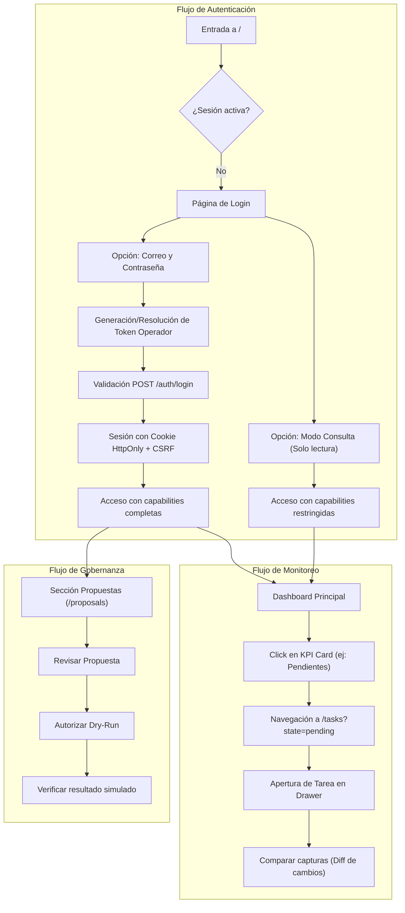

# Guía de Arquitectura, Módulos y Flujos del Frontend

Este documento detalla la arquitectura, estructura de componentes, módulos funcionales, flujos de usuario y estado de verificación de la plataforma web del proyecto.

---

## 1. Resumen Ejecutivo y Stack Tecnológico

La interfaz web (H5) es un Single Page Application (SPA) moderno desarrollado con **React 19** y **TypeScript**, empaquetado con **Vite**. Funciona como un adaptador visual para el motor de gestión de proyectos, consumiendo la API REST del backend sin duplicar lógica de negocio ni realizar estimaciones locales en el navegador.

| Tecnología | Versión | Rol en el Proyecto |
|---|---|---|
| **React** | 19.3.0 | Biblioteca central de renderizado y componentes declarativos |
| **TypeScript** | 5.9.3 | Tipado estático estricto y contratos de DTOs con la API |
| **Vite** | 8.3.4 | Entorno de desarrollo rápido, proxy a la API y compilador optimizado |
| **TailwindCSS** | 4.3.3 | Sistema de diseño basado en variables semánticas (`data-theme="dark" / light`) |
| **React Router** | 7.18.4 | Enrutamiento SPA del lado del cliente sincronizado con parámetros URL |
| **TanStack Query** | 5.104.2 | Caché de servidor, gestión de estados de red (loading/error) y reintentos |
| **Recharts** | 3.8.0 | Gráficos SVG interactivos (barras, áreas y series temporales) |
| **Lucide React** | 0.577.0 | Iconografía limpia y accesible |
| **Playwright** | 1.64.0 | Suite de 40 pruebas End-to-End (E2E) herméticas y móviles |

---

## 2. Estructura del Código Fuente

El código se organiza siguiendo la arquitectura basada en funcionalidades (*feature-based architecture*):

```text
frontend/src/
├── api/                   # Cliente HTTP, contratos TypeScript y react-query hooks
│   ├── client.ts          # Cliente fetch centralizado con CSRF y manejo de errores
│   ├── formatters.ts      # Formateadores de fecha (Guayaquil), porcentaje y duraciones
│   ├── queries.ts         # Query keys y custom hooks de TanStack Query
│   └── types.ts           # DTOs y tipos de dominio importados del backend
├── app/                   # Shell de la aplicación y proveedores globales
│   ├── App.tsx            # Rutas del enrutador y protección de autenticación
│   ├── AppShell.tsx       # Barra lateral, cabecera superior y navegación
│   └── WorkspaceContext.tsx # Contexto del proyecto activo seleccionado
├── components/            # Componentes reutilizables de UI
│   ├── Dialog.tsx         # Modal accesible basado en Radix UI
│   ├── Drawer.tsx         # Panel lateral deslizante para detalle de tareas
│   ├── FeedbackToast.tsx  # Sistema de notificaciones toast accesible
│   └── States.tsx         # Estados visuales estándar: LoadingState, ErrorState, EmptyState, Pill
├── features/              # Módulos funcionales de la aplicación
│   ├── auth/              # LoginPage, LoginDialog, SessionProvider, gestión de tokens
│   ├── dashboard/         # DashboardPage, MetricCard, ExecutiveInsights, gráficos
│   ├── tasks/             # TasksPage, TaskTable, TaskDrawer, comparador de capturas
│   ├── proposals/         # ProposalsPage, revisión de propuestas, autorización dry-run
│   ├── reports/           # ReportsPage, decisión sobre informes, visor Markdown seguro
│   ├── quality/           # QualityPage, hallazgos de código, políticas Q1-Q3
│   ├── analysis/          # AnalysisPage, preparación, confirmación y polling de ejecuciones
│   ├── calendar/          # CalendarPage, ciclo semanal, outbox y ejecuciones forzadas
│   ├── audit/             # AuditPage, visualización de auditoría inmutable
│   ├── projects/          # ProjectsPage, cartera de proyectos y paginación
│   ├── settings/          # SettingsPage, estado de runtime y preferencias locales
│   └── theme/             # Selector de modo claro / oscuro persistido en localStorage
└── styles.css             # Design system unificado con CSS variables y Tailwind
```

---

## 3. Módulos Desarrollados y Funcionalidades

### 3.1. Autenticación y Control de Sesión (`features/auth/`)
- **Página de Login (`LoginPage.tsx`)**: Pantalla de aterrizaje cuando no hay sesión iniciada. Permite ingresar con correo y contraseña para derivar el token de operador, o ingresar en «Modo Consulta» (solo lectura).
- **Gestión de Sesión (`SessionProvider.tsx`)**: Gestiona la sesión respaldada por cookie `HttpOnly` y token `CSRF`. Expone el rol del actor y la lista de `capabilities` activas (`audit:read`, `analysis:prepare`, `governance`, etc.).
- **Diálogo de Acceso Rápido (`LoginDialog.tsx`)**: Permite elevar privilegios o cerrar sesión desde la barra superior sin recargar la página.

### 3.2. Dashboard Ejecutivo (`features/dashboard/`)
- **Grilla de Métricas Compactas (`.metric-grid`, `.metric-card`)**: 10 tarjetas de KPIs organizadas en 5 columnas en escritorio (altura compacta de 80px):
  - *Fila 1 (Volumen y progreso)*: Tareas registradas, Completadas, Pendientes, En curso, Avance observado.
  - *Fila 2 (Salud y alertas)*: Vencidas, Próximas a vencer, Bloqueadas, Actividades críticas, Estado desconocido.
- **Gráficos de Distribución (`StateDistributionChart`, `CriticalSignalsChart`)**: Barras de tareas por estado y señales de riesgo con altura contenida (185px) y listas de datos accesibles.
- **Lista de Tareas Críticas**: Vista rápida de las tareas de mayor urgencia reportadas por la API.
- **Atajos de Seguimiento (`.alert-shortcuts`)**: Barra de acción rápida para filtrar vencidas, bloqueadas o críticas con un solo clic.
- **Historial de Capturas (`CaptureCharts`)**: Gráfico de área para la evolución del avance porcentual y gráfico de barras para el volumen total de tareas por captura.
- **Métricas de Calidad y Políticas (`ExecutiveInsights.tsx`)**: Tarjetas de estado de calidad, evaluación de políticas obligatorias (Q1, Q2) y recomendación del último informe generado.

### 3.3. Explorador de Tareas y Comparador (`features/tasks/`)
- **Tabla de Tareas (`TaskTable.tsx`)**: Vista tabular con soporte de paginación en servidor y ordenamiento por título o fecha límite.
- **Filtros Sincronizados con URL**: Búsqueda por texto (`q`), estado (`state`), responsable (`assignee_id`), lista/fase (`list_name`), solo vencidas (`overdue_only`), solo próximas (`due_soon_only`) y solo críticas (`critical_only`).
- **Drawer de Detalle de Tarea (`TaskDrawer.tsx`)**: Panel lateral que muestra fechas, etiquetas, dependencias explícitas observadas e impactos calculados sin inventar relaciones.
- **Comparador de Cambios entre Capturas**: Permite contrastar dos capturas históricas y visualizar las diferencias exactas de campos (`diff-before` / `diff-after`).

### 3.4. Gobernanza y Propuestas de Acción (`features/proposals/`)
- **Listado de Propuestas**: Inspección de propuestas emitidas por el agente ejecutor (`start_date`, `due_date`, `assignee_ids`).
- **Revisión Técnica**: Opciones para registrar una revisión técnica (`approve_offline` o `reject`) ligada a la versión de la propuesta.
- **Autorización de Simulación**: Permiso independiente de simulación (*dry-run*) sin ejecutar mutaciones reales sobre Trello.
- **Historial de Simulaciones**: Visualización de los resultados simulados y razones de bloqueo.

### 3.5. Informes Ejecutivos (`features/reports/`)
- **Visor de Informes**: Renderizado seguro de Markdown sanitizado (neutralizando inyecciones HTML peligrosas o URLs `javascript:`).
- **Toma de Decisión Humana**: Registro de decisión del gestor (`approve`, `reject`, `request_changes`, `postpone`) con motivo justificado, persistido en SQLite.
- **Exportación / Descarga**: Descarga directa de informes en formato `.md` o `.json`.

### 3.6. Centro de Calidad de Código (`features/quality/`)
- **Métricas de Calidad**: Conteo de hallazgos candidatos, confirmados por el Verificador, rechazados o con evidencia insuficiente.
- **Inspección de Hallazgos**: Diálogo modal con el fragmento de código auditado (`code_excerpt`), regla violada, severidad y justificación del Verificador.
- **Evaluación de Políticas**: Semáforo de reglas (Q1 Cobertura mínima documentada, Q2 Verificación independiente, Q3 Estilo y límites).

### 3.7. Centro de Análisis de IA (`features/analysis/`)
- **Preparación de Análisis**: Verificación de preflight (fuentes configuradas, presencia de credenciales, modo trello/github) sin invocar APIs externas de forma imprevista.
- **Protección Anti-Ráfaga en UI**: Los botones de acción se deshabilitan inmediatamente durante la mutación (`disabled={isPending}`), previniendo dobles clics o envíos repetidos desde el navegador mientras una solicitud está en vuelo.
- **Confirmación con Consentimiento Remoto**: Diálogo explícito con checkbox de consentimiento antes de autorizar el despacho a modelos remotos, enviando un encabezado de idempotencia (`Idempotency-Key`).
- **Monitor de Trabajos en Tiempo Real**: Polling reactivo con backoff sobre el estado del job (`queued`, `running`, `completed`, `failed`, `interrupted`).

### 3.8. Calendario y Ciclo Semanal (`features/calendar/`)
- **Programación Semanal**: Muestra el día (viernes), hora (17:00) y zona horaria (`America/Guayaquil`).
- **Disparo Manual Forzado**: Capacidad de ejecutar el ciclo semanal fuera de fecha usando `--force`.
- **Bandeja Outbox**: Historial de recibos generados con identificador de entrega, asunto y opción de descarga del artefacto despachado.

### 3.9. Auditoría y Ajustes (`features/audit/`, `features/settings/`)
- **Registro de Auditoría**: Tabla inmutable de eventos con tipo de evento, actor verificado, recurso afectado y marca de tiempo.
- **Ajustes de Runtime**: Visualización del origen de datos, estado de escrituras externas y selector de tema claro / oscuro.

---

## 4. Flujos de Usuario Implementados



---

## 5. Estado de Verificación y Calidad

El frontend se encuentra completamente probado y verificado mediante suites automáticas:

1. **TypeScript Typecheck (`npm run typecheck`)**: 0 errores de tipado.
2. **Compilación de Producción (`npm run build`)**: Genera el bundle optimizado sin advertencias en `frontend/dist/`.
3. **Playwright E2E Suite (`npm run test:e2e`)**: **40 de 40 pruebas en verde**, cubriendo:
   - Sincronización de KPIs y filtros de tareas.
   - Responsividad móvil (390x844) sin desbordamiento horizontal.
   - Seguridad: aislamiento de tokens (nunca en `localStorage`), protección CSRF en logout.
   - Manejo de respuestas `unknown` y errores 503 sin inventar datos en el cliente.
4. **Verificación de Integración (`node scripts/check_web_foundation.mjs`)**: 4 de 4 checks HTTP reales superados.

