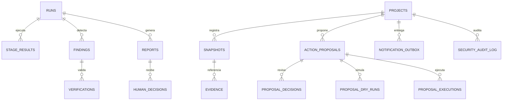

# Guía de Arquitectura, API REST y Persistencia del Backend

Este documento detalla la arquitectura en capas, puertos y adaptadores, catálogo completo de endpoints de la API, modelo de seguridad/RBAC y persistencia en base de datos SQLite del backend.

---

## 1. Resumen Ejecutivo y Principios de Diseño

El backend está desarrollado en **Python 3.14** utilizando **FastAPI** y **Pydantic v2**, operando sobre el servidor ASGI **Uvicorn**.

Está estructurado bajo una **Arquitectura Hexagonal (Puertos y Adaptadores)** con separación estricta de responsabilidades:
- **Cero llamadas no autorizadas a la nube**: No se invocan modelos LLM ni APIs externas (GitHub/Trello) de forma desatendida durante consultas habituales de lectura.
- **Determinismo matemático y aislamiento**: Las métricas de planificación, plazos y dependencias se calculan mediante algoritmos deterministas en Python, no mediante interpretaciones probabilísticas de LLMs.
- **Inmutabilidad y soberanía**: La persistencia utiliza SQLite directo con disparadores (*triggers*) `BEFORE UPDATE / BEFORE DELETE` que impiden la alteración o borrado de evidencias históricas.

---

## 2. Arquitectura en Capas del Backend

```text
src/agente_gestion/
├── domain/                # Núcleo de dominio puro (sin I/O ni dependencias externas)
│   ├── tasks.py           # TaskCard, DomainTaskState, TaskPlanSummary, reglas de plazos
│   ├── action_proposals.py# ActionProposal, ProposalDecision, validaciones de mutación
│   ├── quality.py         # CodeFinding, VerificationVerdict, reglas Q1–Q3
│   ├── weekly_schedule.py # WeeklySchedule, cálculo determinista de ventanas temporales
│   └── security.py        # SystemRole, Permission, ExecutionActor, reglas RBAC
├── ports/                 # Interfaces abstractas (Protocolos / ABCs)
│   ├── task_source.py     # TaskSourcePort (abstracción de lectura de tableros)
│   ├── action_port.py     # TaskActionPort (abstracción de mutación segura de tareas)
│   ├── llm_port.py        # LLMPort (abstracción de proveedores de lenguaje)
│   ├── storage_port.py    # StoragePort (abstracción de persistencia histórica)
│   └── outbox_port.py     # OutboxPort (abstracción de entrega de notificaciones)
├── adapters/              # Implementaciones concretas de infraestructura
│   ├── sources/           # TrelloSourceAdapter, GitHubSourceAdapter, Composite
│   ├── storage/           # SQLiteStorageAdapter, consultas indexadas por proyecto
│   ├── llm/               # Adaptadores para Groq, Gemini, Ollama y Mock local
│   └── outbox/            # HybridNotificationOutboxAdapter (disco y SQLite)
├── application/           # Servicios de aplicación y casos de uso
│   ├── orchestrator.py    # ProjectOrchestrator: coordinación del pipeline
│   ├── weekly_scheduler.py# WeeklySchedulerService: agregación semanal y outbox
│   ├── tasks_query.py     # Servicio de filtrado, paginación y ordenamiento de tareas
│   └── security.py        # enforce_rbac, assert_safe_remote_payload, hashing
└── api/                   # Capa web y endpoints HTTP (FastAPI)
    ├── app.py             # Creación de FastAPI app, middlewares CORS y TrustedHost
    ├── settings.py        # ApiSettings, ProjectConfig, carga de variables de entorno
    ├── routes.py          # Definición de todos los endpoints REST (/api/v1)
    ├── schemas.py         # DTOs Pydantic de entrada y salida
    └── sessions.py        # OperatorSessionStore, cookies HttpOnly y validación CSRF
```

---

## 3. Catálogo de Endpoints de la API REST (`/api/v1`)

Todos los endpoints retornan respuestas tipadas bajo `/api/v1` y manejan errores con el estándar RFC 7807 (`ApiProblem`).

| Método | Ruta | Descripción | Nivel de Acceso |
|---|---|---|---|
| `GET` | `/system/health` | Estado del servicio y versión de runtime | Público |
| `GET` | `/auth/session` | Estado de la sesión actual y capabilities activas | Público / Sesión |
| `POST` | `/auth/login` | Autenticación con token de operador; emite cookie `HttpOnly` | Público (con origen exacto) |
| `POST` | `/auth/logout` | Revocación de sesión y limpieza de cookie | Requiere sesión + CSRF |
| `GET` | `/projects` | Lista paginada de proyectos disponibles | Público |
| `GET` | `/projects/{id}` | Metadatos y modo de origen de un proyecto | Público |
| `GET` | `/projects/{id}/summary` | Resumen de planificación y conteo de estados | Público |
| `GET` | `/projects/{id}/history` | Historial de capturas registradas para series temporales | Público |
| `GET` | `/projects/{id}/compare` | Comparación determinista entre dos capturas | Público |
| `GET` | `/projects/{id}/tasks` | Explorador de tareas con filtros (estado, responsable, etc.) | Público |
| `GET` | `/projects/{id}/tasks/{task_id}` | Detalle completo de una tarea y su evidencia observada | Público |
| `GET` | `/projects/{id}/proposals` | Listado de propuestas de acción generadas | Público |
| `GET` | `/projects/{id}/proposals/{prop_id}` | Detalle de propuesta y su historial de decisiones | Público |
| `POST` | `/projects/{id}/proposals/{prop_id}/execute` | Revisor técnico automático y decisión humana con ejecución protegida | Operador (`governance:proposal_execute`) |
| `POST` | `/runs/{run_id}/findings/{finding_id}/decision` | Decidir sobre código validado contra fuente completa y crear rama separada | Operador (`quality:decide`) |
| `POST` | `/projects/{id}/notifications/email` | Enviar resumen/reenviar recibo con destinatario confirmado | Operador (`notifications:email_send`) |
| `GET` | `/runs` | Listado paginado de ejecuciones del pipeline | Público |
| `GET` | `/runs/{run_id}` | Detalle de etapas de una ejecución y sus duraciones | Público |
| `GET` | `/runs/{run_id}/findings` | Hallazgos de calidad candidatos de una ejecución | Público |
| `GET` | `/runs/{run_id}/findings/{id}` | Detalle de hallazgo, veredicto y extracto de código | Público |
| `POST` | `/analysis/prepare` | Preflight check para análisis con IA | Operador (`analysis:prepare`) |
| `POST` | `/analysis/confirm` | Confirmación e inicio de trabajo asíncrono con IA | Operador (`analysis:confirm`) |
| `GET` | `/analysis/jobs` | Cola de trabajos de análisis persistidos | Operador (`analysis:confirm`) |
| `GET` | `/analysis/jobs/{job_id}` | Polling de estado de un trabajo de análisis | Operador (`analysis:confirm`) |
| `GET` | `/projects/{id}/reports` | Lista de informes ejecutivos almacenados | Público |
| `GET` | `/projects/{id}/reports/{report_id}` | Contenido en Markdown sanitizado del informe | Público |
| `POST` | `/projects/{id}/reports/{report_id}/decision` | Registro de decisión humana sobre el informe | Operador (`reports:decide`) |
| `GET` | `/projects/{id}/reports/{report_id}/download` | Descarga de informe en `.md` o `.json` | Público |
| `GET` | `/projects/{id}/schedule` | Configuración y estado de la ventana semanal | Público |
| `GET` | `/projects/{id}/schedule/outbox` | Historial de recibos de entrega semanal | Público |
| `GET` | `/projects/{id}/schedule/outbox/{id}` | Detalle del recibo y mensaje emitido | Público |
| `GET` | `/projects/{id}/schedule/outbox/{id}/download` | Descarga de entrega en `.md` o `.json` | Público |
| `POST` | `/projects/{id}/schedule/manual-cycle/prepare` | Preflight check de ejecución manual del ciclo | Operador (`weekly_cycle:confirm`) |
| `POST` | `/projects/{id}/schedule/manual-cycle/confirm` | Disparo forzado del ciclo semanal SQLite | Operador (`weekly_cycle:confirm`) |
| `GET` | `/projects/{id}/audit` | Consulta de la tabla de auditoría inmutable | Operador (`audit:read`) |
| `GET` | `/projects/{id}/configuration` | Configuración activa del proyecto (sin secretos) | Operador (`configuration:read`) |

---

## 4. Seguridad, RBAC y Control de Acceso

### 4.1. Roles y Permisos Granulares
El backend define 7 roles formales (`SystemRole`):
1. `DEVELOPER`: Consulta de código y tareas.
2. `MONITORING`: Rol del agente ejecutor de seguimiento.
3. `QUALITY`: Rol del agente revisor de código.
4. `VERIFIER`: Rol del agente verificador independiente.
5. `REPORT`: Rol del agente de síntesis y reportes.
6. `PROJECT_MANAGER`: Gestor con capacidad de toma de decisiones humanas y autorización.
7. `ADMIN`: Administración del sistema.

La función `enforce_rbac(actor, permission)` evalúa en memoria si el actor posee el permiso antes de ejecutar cualquier mutación, rechazando llamadas no autorizadas con código `403 Forbidden`.

### 4.2. Protección de Sesiones y Cookies
- Las sesiones no se almacenan en `localStorage` ni exponen credenciales al navegador.
- Se emite una cookie segura:
  - `HttpOnly`: inaccesible desde JavaScript para mitigar ataques XSS.
  - `SameSite=Strict`: prevención estricta de Cross-Site Request Forgery (CSRF).
  - `Path=/api/v1`: alcance restringido exclusivamente a las rutas de la API.
- Las mutaciones de estado exigen el encabezado `X-CSRF-Token` emitido por el servidor.

### 4.3. Política de Soberanía Cloud y Fuga de Secretos
- **Filtro Recursivo de Payloads (`assert_safe_remote_payload`)**: Antes de que cualquier cadena salga hacia un LLM (Gemini/Groq), se inspecciona para detectar y bloquear:
  - Archivos `.env` o variables de entorno.
  - Bloques de certificados o claves privadas (`BEGIN PRIVATE KEY`).
  - Patrones de tokens de API de terceros.
- **Política por Proyecto (`assert_cloud_transfer_policy`)**: Si un proyecto tiene configurado `allow_remote_ai: false`, cualquier intento de llamada a APIs externas falla inmediatamente (*fail-closed*).

### 4.4. Control de Concurrencia, Idempotencia y Protección Anti-Ráfaga (`AnalysisJobService`)
Para prevenir que solicitudes repetidas, dobles clics o peticiones concurrentes sobrecarguen el servidor o disparen ejecuciones redundantes de agentes:
1. **Transacción Inmediata en Base de Datos**: Cada registro de trabajo en [`AnalysisJobLedger`](file:///home/saimoljimenez/Univercidad/GestionProyectos/AgenteGestionProyectos/src/agente_gestion/api/analysis_jobs.py#L367) se realiza bajo `BEGIN IMMEDIATE` en SQLite para evitar condiciones de carrera (*race conditions*).
2. **Detección de Análisis Activo (HTTP 409 `analisis_en_curso`)**: Antes de crear un trabajo, se verifica si ya existe uno en estado `queued` o `running` para el proyecto. Si existe, la petición se rechaza de inmediato con código `409 Conflict`, impidiendo ráfagas de análisis concurrentes.
3. **Clave de Idempotencia (`Idempotency-Key`)**: Si un cliente reenvía la misma petición con el mismo hash de idempotencia, el servidor retorna el trabajo previo sin encolar uno nuevo (`reused: true`).
4. **Capacidad de Cola y Worker Único**: El servicio limita la cola mediante `queue_capacity` (HTTP 429 si se satura) y procesa las tareas secuencialmente en un worker dedicado (`ThreadPoolExecutor(max_workers=1)`).

---

## 5. Esquema de Base de Datos SQLite (`.runtime/agente.db`)

La persistencia histórica se asienta en SQLite local sin dependencias complejas. La integridad de auditoría se garantiza mediante disparadores inmutables:



### Tablas Principales

1. `snapshots`: Capturas completas del tablero Trello serializadas en JSON inmutable con hash SHA-256 (`content_hash`).
2. `runs`: Registro de cada ejecución completa del pipeline (duración, estado, timestamp).
3. `stage_results`: Tiempos y estados de cada etapa individual (`source_collection`, `monitoring`, `quality`, `verifier`, `report`).
4. `findings`: Hallazgos de calidad de código detectados en diffs (severidad, regla Q1–Q3, archivo y línea).
5. `verifications`: Veredicto emitido por el `VerifierAgent` (`confirmed`, `rejected`, `insufficient`).
6. `reports`: Informes finales consolidados generados para el proyecto.
7. `human_decisions`: Registro inmutable de la decisión tomada por el usuario humano sobre el informe.
8. `action_proposals`: Catálogo de propuestas de acción con motivo, evidencia e impacto.
9. `proposal_executions`: Historial de ejecuciones reales sobre proveedores externos (Trello) con verificación post-escritura.
10. `notification_outbox`: Registro de recibos idempotentes despachados en cada ventana semanal.
11. `security_audit_log`: Ledger inmutable protegido por disparadores `BEFORE UPDATE` y `BEFORE DELETE` donde se asientan todos los eventos de seguridad.

---

## 6. Modos de Ejecución del Servidor

El servidor puede iniciarse en dos modalidades desde la raíz del proyecto:

### Modo A: Base configurada (`.runtime/agente.db`)
Carga exclusivamente el contenido de la base configurada. Tras la regeneración de demostración, son datos de prueba nuevos, no historial auténtico de HORMIGESTION. No uses una credencial pública de fixture en una base privada; aprovisioná `H5_OPERATOR_TOKEN` de forma segura:

```bash
PYTHONPATH=src .venv/bin/python -m uvicorn agente_gestion.api.app:app --host 127.0.0.1 --port 8000 --workers 1
```

### Modo B: Demostración Aislada con Base Temporal Desechable
Crea una base efímera bajo `.runtime/`, precargada con datos controlados de prueba:
```bash
.venv/bin/python scripts/serve_web_demo.py --dataset fixture --port 8000
```

