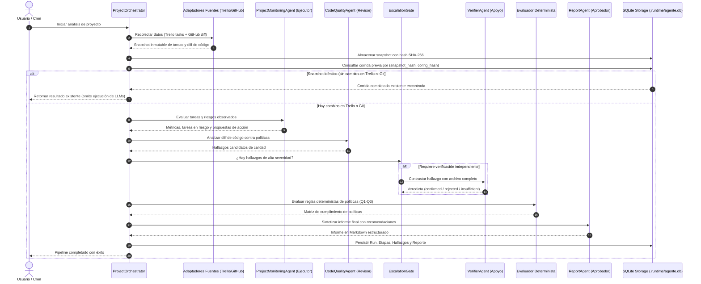
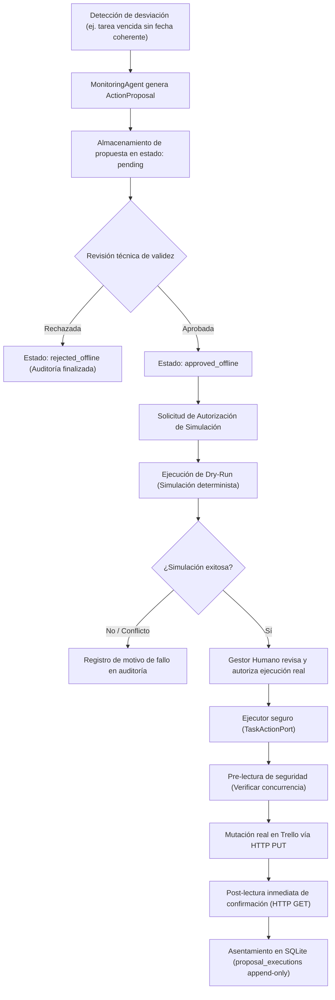

# Guía del Motor de Agentes, Flujos y Matriz de Requisitos

Este documento explica en detalle el funcionamiento del motor multiagente, sus flujos de ejecución y el estado de cumplimiento contra la **matriz de requisitos académicos (REQ-01 a REQ-11)** definida en el plan de implementación.

---

## 1. ¿Qué es realmente el Motor de Agentes?

El motor de agentes no es un agente monolítico ni una caja negra de chat interactivo libre. Se trata de un **sistema multiagente estructurado bajo orquestación determinista**.

Cada agente es un módulo especializado con un rol acotado, un contrato de entrada/salida validado por Pydantic y barreras de seguridad (*guardrails*):
1. **Los agentes no inventan datos ni relaciones**: Toda métrica de plazos, días de retraso o dependencias se calcula matemáticamente antes de alimentar el contexto del LLM (*grounding* estricto).
2. **Los agentes proponen, el humano dispone**: Ningún agente escribe en Trello o en repositorios sin una propuesta formal, revisión técnica, simulación (*dry-run*) y autorización explícita del gestor humano.
3. **Reducción de alucinaciones (0.00% FPR)**: Un agente revisor de código no se autoevalúa; un agente verificador independiente valida hallazgos críticos contrastándolos con el código fuente completo.

---

## 2. Los Roles del Motor y su Equivalencia Académica

La cátedra universitaria solicita una arquitectura basada en **3 roles de agentes + autoridad humana**. El proyecto implementa esta correspondencia funcional de forma rigurosa:

| Rol Académico | Agente / Componente | Función Real en el Código | Proveedor Predeterminado |
|---|---|---|---|
| **Coordinador** | `ProjectOrchestrator` | Orquestador secuencial en Python. Coordina etapas, evalúa condiciones de salida y maneja fallos. | Python (código determinista) |
| **Ejecutor** | `ProjectMonitoringAgent` | Agente de seguimiento. Analiza el estado de las tareas de Trello, detecta bloqueos, riesgos de plazo y emite propuestas de acción (`ActionProposal`). | Gemini 3.5 Flash Lite / Local |
| **Revisor** | `CodeQualityAgent` | Agente de calidad. Inspecciona diffs de GitHub contra reglas predefinidas (Q1–Q3) y genera hallazgos candidatos. | Groq (Qwen 3.8 27B) |
| **Subagente del Revisor** | `VerifierAgent` | Agente de verificación independiente. Activado por `EscalationGate` ante hallazgos de alta severidad para corroborar con código fuente completo. | Gemini 3.5 Flash Lite |
| **Aprobador Consultivo** | `ReportAgent` | Agente de síntesis. Consolida métricas, riesgos observados y genera el informe ejecutivo semanal en Markdown. | Gemini 3.5 Flash Lite |
| **Autoridad Final** | **Gestor Humano** | El usuario humano soberano. Aprueba o rechaza propuestas en Trello y decide sobre los informes en SQLite (`human_decisions`). | Decisión Humana (Web / CLI) |

---

## 3. Flujos de Ejecución del Motor

### Flujo 1: Pipeline de Análisis y Evaluación Integral
Es el ciclo principal de inspección del proyecto ejecutado por el orquestador:

> [!IMPORTANT]
> **Detección de Cambios en Trello y Git (Caché Criptográfico de Estado)**:
> En el paso 2 de [`Orchestrator.execute`](file:///home/saimoljimenez/Univercidad/GestionProyectos/AgenteGestionProyectos/src/agente_gestion/application/orchestrator.py#L212-L217), el sistema calcula el `snapshot_hash` (huella SHA-256 de todas las tarjetas de Trello, fechas de vencimiento, estados y diffs de Git). Si este hash y la configuración son idénticos a una corrida previa completada (`find_run_by_fingerprint`), el orquestador **omite por completo la ejecución de los agentes de IA** (`CodeQualityAgent`, `VerifierAgent` y `ReportAgent`) y retorna de inmediato la corrida previa. Esto previene llamadas innecesarias a APIs externas y acelera la respuesta a milisegundos cuando no hay cambios.

---

### Flujo 2: Ciclo de Gobernanza y Mutación Segura en Trello
Garantiza que ninguna tarjeta sea modificada sin supervisión humana y validación previa:

---

## 4. Matriz de Requisitos Académicos (REQ-01 a REQ-11)

Esta matriz contrasta lo solicitado en el documento académico de la materia (`AgenteIA.pdf`) contra el estado real del código implementado en el repositorio:

| Requisito | Descripción Académica | Estado Real | Qué está Desarrollado | Qué Falta para el Cierre Final |
|---|---|---|---|---|
| **REQ-01** | Planificación general del proyecto (responsables, fechas, prioridades). | **CUMPLIDO** | `TaskCard` normaliza inicio, fin, responsable y prioridad real. Exposición en CLI (`tasks list/summary/show`) y Frontend (`/tasks`). | Ninguno en lógica central. Validaciones de acciones externas integradas. |
| **REQ-02** | Estado y avance de actividades (% completado, estados de tareas, alertas). | **CUMPLIDO** | Estados del dominio (`pending`, `en_curso`, `completada`, `bloqueada`, `desconocido`), cálculo de avance y ventana configurable de próximas a vencer (`due_soon_days`). Gráficos y tabla en frontend. | Daemon continuo a nivel de sistema operativo (actualmente se ejecuta por demanda/CLI/Web). |
| **REQ-03** | Integración con Trello y detección de cambios históricos. | **CUMPLIDO** | `TrelloSourceAdapter` para lectura en vivo. Comparador determinista entre capturas (`compare_task_snapshots`), historial inmutable en SQLite y diff visual en frontend. | Ninguno. Se verificó con datos reales de HORMIGESTION (31 tareas). |
| **REQ-04** | Detección de retrasos, dependencias y riesgos de planificación. | **CUMPLIDO** | Detección matemática de tareas vencidas, en riesgo y bloqueadas. Análisis de dependencias explícitas registradas sin alucinar relaciones no existentes. | Ninguno. Totalmente integrado en dashboard y reportes. |
| **REQ-05** | Formulación y ejecución de acciones correctivas en Trello. | **CUMPLIDO** | Ciclo completo: generación de `ActionProposal`, revisión técnica, autorización, simulación *dry-run* y ejecutor `execute_proposal_action` con pre-read, mutación PUT y post-read verificado. Prueba live completada en tarjeta real de Trello con restauración no destructiva (`scripts/check_action_trello.py`). | Ninguno en backend/ejecución. El circuito completo está auditado y funcional. |
| **REQ-06** | Generación de reporte semanal de seguimiento y outbox de notificación. | **CUMPLIDO** | `WeeklySchedulerService` con especificación semanal (corte viernes 17:00 Guayaquil), soporte de forzado manual (`--force`), agregación de métricas, y outbox idempotente con recibos en SQLite y archivos `.md`/`.json`. Vista en frontend (`/calendar`). | Configurar cronjob / systemd en servidor de producción. |
| **REQ-07** | Revisión de calidad de código basada en diffs de GitHub. | **CUMPLIDO** | `CodeQualityAgent` + `VerifierAgent` independiente con `EscalationGate`. Reglas Q1–Q3. Suite de benchmark (`quality benchmark`) con dataset ground-truth que certifica **0.00 % falsos positivos** y **100 % de precisión**. | Integración con pipeline CI externo tipo GitHub Actions (opcional, el analizador local ya funciona). |
| **REQ-08** | Arquitectura con 3 roles de agentes + autorización humana soberana. | **CUMPLIDO** | Separación funcional estricta: Elaborador (Monitoring), Revisor (Quality con Verifier de apoyo), Aprobador consultivo (Report) y Gestor Humano con permisos RBAC en SQLite (`human_decisions`). | Integración corporativa con SSO/SAML (fuera del alcance MVP). |
| **REQ-09** | Interacción y gobernanza de decisiones del gestor. | **CUMPLIDO** | CLI completo de decisiones (`proposals decide/dry-run`, `reports decide`) y plataforma web completa H5 (vistas de propuestas, revisión, informes y auditoría). | Ninguno. Ambos canales (CLI y Web) están completamente operativos. |
| **REQ-10** | Trazabilidad completa y auditoría de eventos. | **CUMPLIDO** | Base SQLite (`.runtime/agente.db`) con 16 tablas vinculadas. Triggers append-only en `security_audit_log` y `proposal_executions` que impiden borrado o actualización de eventos pasados. | Ninguno. Trazabilidad de extremo a extremo comprobada. |
| **REQ-11** | Seguridad integral, protección de credenciales y soberanía de datos. | **CUMPLIDO** | Control de acceso RBAC (`enforce_rbac`), sanitización automática de payloads contra fuga de `.env` o llaves privadas (`assert_safe_remote_payload`), cookies `HttpOnly`/`SameSite=Strict`, protección CSRF y políticas de soberanía cloud por proyecto. | Rotación automática de llaves criptográficas (no exigida para la materia). |

---

## 5. Hitos del Plan de Implementación (H0 a H5)

El desarrollo del proyecto se ejecutó y estructuró a través de 6 hitos incrementales:

- **Hito H0 (MVP y Fuentes Reales)**: Conexión con la API de Trello del proyecto HORMIGESTION y repositorio GitHub (`Josu-F1/hormigestion-backend`), logrando la primera captura real.
- **Hito H1 (Seguimiento y Detección de Cambios)**: Normalización de tareas, estados del dominio, cálculo de plazos y motor de comparación determinista de snapshots.
- **Hito H2 (Propuestas, Simulación y Ejecución Segura en Trello)**: Ciclo de vida de `ActionProposal`, permisos de simulación dry-run, ejecutor HTTP de Trello y prueba real con restauración no destructiva.
- **Hito H3 (Ciclo Semanal y Outbox Automatizado)**: Planificador temporal con corte los viernes a las 17:00, agregador integral de reportes y buzón de salida idempotente.
- **Hito H4 (Seguridad, RBAC y Benchmark de Calidad)**: Implementación de roles y permisos, sanitización de fuga de secretos a la nube y suite de benchmark con 0% de falsos positivos en calidad de código.
- **Hito H5 (Plataforma Web y Dashboard)**: Desarrollo de la aplicación web completa en React 19, autenticación con token de operador, rediseño de dashboard compacto y suite de 40 pruebas E2E con Playwright.

---

## 6. Conclusión: ¿Dónde estamos parados y qué falta?

### Lo que el proyecto YA TIENE desarrollado y probado
1. **Un motor multiagente robusto y seguro**: Todos los agentes de seguimiento, calidad, verificación y reportes están terminados, probados con 738 pruebas unitarias/integración en Python y un benchmark de calidad de 100% de precisión.
2. **Un backend FastAPI completo**: Todos los endpoints REST implementados con sesiones seguras, RBAC y persistencia inmutable en SQLite.
3. **Una plataforma web moderna y accesible**: Frontend SPA en React 19 con inicio de sesión, dashboard rediseñado sin ruido visual, explorador de tareas con comparador de cambios, centro de calidad y gobernanza de propuestas.
4. **Validación real sobre HORMIGESTION**: Probado sobre la base de datos real con 31 tareas reales del tablero de Trello.

### Lo que falta para la entrega final ante el docente
1. **Demostración en vivo (Defensa)**:
   - Levantar el backend con la base histórica real (`.venv/bin/python -m uvicorn agente_gestion.api.app:app ...`).
   - Abrir el frontend en `http://127.0.0.1:5173/`.
   - Mostrar el dashboard ejecutivo rediseñado, la inspección de tareas críticas, el informe semanal y la simulación dry-run de una propuesta.
2. **Despliegue desatendido en producción (Opcional para entrega académica)**:
   - Si el docente pide que el scheduler corra 24/7 en un servidor Linux, basta con configurar una unidad de `systemd` o una tarea de `cron` que invoque periódicamente `agente_gestion schedule run HORMIGESTION`.

