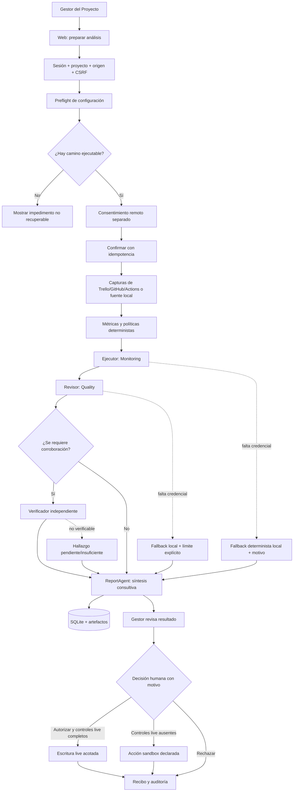

# Motor de agentes y matriz de requisitos

El motor combina métricas y políticas deterministas con agentes de propósito limitado. Cada salida generada por IA queda sujeta a validación y evidencia; las decisiones y acciones finales pertenecen al Gestor del Proyecto autenticado.

## Flujo actual

El `ProjectOrchestrator` coordina etapas y persistencia. El fallback depende de cada componente; un fallo de autenticación, evidencia o integridad no se disfraza como respuesta favorable. El sistema conserva `execution_mode` (`live`, `sandbox` o `mixed`) y `fallback_reasons` para describir el camino observado.

## Roles y autoridad

| Rol | Implementación | Autoridad |
|---|---|---|
| Ejecutor | `ProjectMonitoringAgent` | Analiza tareas/riesgos y puede originar una propuesta; no ejecuta cambios por sí solo. |
| Revisor | `CodeQualityAgent` | Produce hallazgos candidatos de código con referencias; no confirma automáticamente su propia salida. |
| Apoyo independiente | `VerifierAgent` | Corrobora hallazgos cuando el enrutamiento lo requiere; si no hay evidencia suficiente, conserva incertidumbre. |
| Aprobador consultivo | `ReportAgent` | Resume y recomienda dentro de métricas/políticas; no autoriza acciones externas. |
| Aprobador final | Gestor humano `PROJECT_MANAGER` | Aprueba, modifica o rechaza una propuesta con motivo y controles de sesión del servidor. |

El coordinador es lógica de aplicación, no un agente adicional con autoridad. El uso académico de los nombres no cambia las capacidades del código.

## Matriz REQ-01 a REQ-11

La tabla enlaza comportamiento implementado y evidencia local del código. No expresa porcentaje global ni declara que una integración externa haya sido verificada en vivo. La suite backend terminó con 844 pruebas aprobadas y 1 optativa real omitida; la interfaz pasó tipos, compilación y 92 pruebas Playwright. El pipeline determinista se ejecutó sin claves con corrida e informe persistidos. Consultar [INFORME_PRUEBAS.md](../INFORME_PRUEBAS.md) para los límites y advertencias.

| Requisito | Comportamiento visible en el producto | Evidencia de implementación | Límite que se conserva |
|---|---|---|---|
| **REQ-01 · Planificación** | Tareas, responsables, fechas, prioridad observada, filtros y detalle por proyecto. | [Dominio de tareas](../src/agente_gestion/domain/tasks.py), [consulta/paginación](../src/agente_gestion/application/tasks_query.py), [`GET /tasks`](../src/agente_gestion/api/routes.py). | La ausencia de un campo observado no se rellena por inferencia. |
| **REQ-02 · Estado y avance** | Estados normalizados, porcentajes, vencidas, próximas, bloqueadas y señales desconocidas. | [Métricas de dominio](../src/agente_gestion/domain/tasks.py), [consultas](../src/agente_gestion/application/tasks_query.py). | Los datos faltantes permanecen `null`/desconocidos; no se convierten en cero ni en avance aprobado. |
| **REQ-03 · Trello e historial** | Lectura de fuente, capturas persistidas, lista de historial y comparación determinista. | [Factory de fuentes](../src/agente_gestion/adapters/sources/factory.py), [comparador](../src/agente_gestion/domain/task_comparison.py), [rutas de historial](../src/agente_gestion/api/routes.py). | Comparar observaciones no atribuye actor ni prueba una operación física en Trello. |
| **REQ-04 · Retrasos y riesgos** | Señales de vencimiento, bloqueos y dependencias solo cuando están explícitamente observadas. | [Reglas de tareas](../src/agente_gestion/domain/tasks.py), [consultas de tareas](../src/agente_gestion/application/tasks_query.py), [agente de seguimiento](../src/agente_gestion/agents/monitoring.py). | El texto generado no puede crear dependencias ni cambiar conteos calculados. |
| **REQ-05 · Acciones correctivas** | Propuestas revisadas automáticamente, decisión humana y ejecución con recibo en modo declarado. | [Caso de uso de ejecución](../src/agente_gestion/application/proposal_execution.py), [router de propuestas](../src/agente_gestion/api/proposal_execution.py), [acciones sandbox](../src/agente_gestion/adapters/sources/sandbox_task_actions.py). | No se afirma que este trabajo haya efectuado una escritura live; una escritura fallida nunca se etiqueta como éxito simulado. |
| **REQ-06 · Reporte y notificación** | Informes, ciclo semanal manual, outbox y canal SMTP/local reportado en recibos. | [Scheduler](../src/agente_gestion/application/weekly_scheduler.py), [ciclo web](../src/agente_gestion/api/weekly_cycles.py), [correo](../src/agente_gestion/api/email_notifications.py). | La ruta manual no prueba un servicio periódico activo; relay aceptado no demuestra entrega al buzón. |
| **REQ-07 · Calidad de código** | Hallazgos candidatos basados en diffs, reglas y evidencia; verificación independiente cuando corresponde. | [Revisor](../src/agente_gestion/agents/quality.py), [verificador](../src/agente_gestion/agents/verifier.py), [evaluador de políticas](../src/agente_gestion/quality/evaluator.py). | Un candidato no es defecto confirmado; CI/cobertura ausentes quedan desconocidos. No se atribuye precisión universal ni porcentaje no medido. |
| **REQ-08 · Roles y autoridad** | Ejecutor, Revisor, verificación auxiliar, síntesis consultiva y decisión humana autenticada. | [Orquestador](../src/agente_gestion/application/orchestrator.py), [reporte consultivo](../src/agente_gestion/agents/report.py), [sesión y capacidades](../src/agente_gestion/api/routes.py). | El agente de informe no es la autoridad final; esa autoridad permanece en el gestor humano. |
| **REQ-09 · Interacción del gestor** | Web para preparar análisis, revisar tareas/hallazgos/propuestas, decidir y consultar recibos. | [Rutas REST](../src/agente_gestion/api/routes.py), [acciones de hallazgos](../src/agente_gestion/api/finding_actions.py), [frontend](../frontend/src/app/App.tsx). | La interfaz refleja el estado recibido del backend; no conserva una aprobación local alternativa. |
| **REQ-10 · Trazabilidad** | Corridas, etapas, decisiones, trabajos, outbox y eventos se registran en SQLite y se consultan según permiso. | [Persistencia SQLite](../src/agente_gestion/adapters/storage/sqlite.py), [control plane](../src/agente_gestion/api/control_plane.py), [auditoría API](../src/agente_gestion/api/routes.py). | Hash o append-only no prueba por sí solo autoría externa ni entrega de proveedor. |
| **REQ-11 · Seguridad** | Sesión de servidor, origen permitido, CSRF, alcance, idempotencia, secretos fuera de DTOs y puertas separadas para remoto/escritura. | [Seguridad web](../src/agente_gestion/api/security.py), [configuración](../src/agente_gestion/api/settings.py), [seguridad de aplicación](../src/agente_gestion/application/security.py). | Credencial presente no prueba permiso/connectividad; flags no sustituyen consentimiento ni decisión humana. |

## Grounding y estados de salida

1. Python calcula métricas, fechas y evaluación de reglas antes de redactar.
2. Los agentes reciben contexto acotado y devuelven contratos estructurados.
3. Los validadores comprueban IDs, reglas, archivos, líneas y SHA disponibles.
4. La verificación se ejecuta independientemente cuando el enrutamiento lo pide.
5. `pending`, `insufficient`, `unknown` y `needs_attention` conservan incertidumbre; un fallback no inventa confirmación.
6. La preparación puede ser accionable con fallback local, pero la salida describe si el modo fue `live`, `mixed` o `sandbox` y por qué.

## Límites de la evidencia

Los enlaces anteriores permiten inspeccionar la implementación, no acreditan que una API externa haya sido llamada con éxito. Los tests con transporte falso pueden validar contratos locales, pero no autenticación remota o mutaciones. No se declaran los REQ completamente satisfechos por documentación ni se presenta un porcentaje global de cumplimiento. Los comandos de integración y sus resultados observados están registrados en el informe de verificación; una ejecución local no acredita operaciones live.
