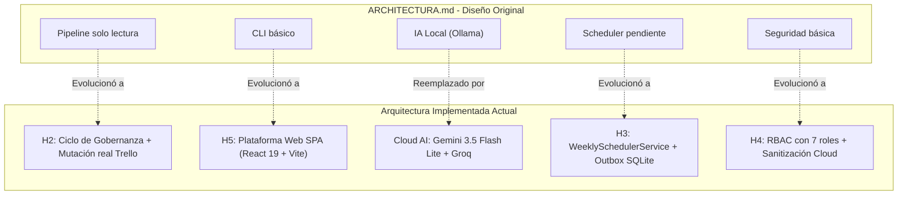

# Análisis Comparativo: Arquitectura Original (ARCHITECTURA.md) vs. Arquitectura Implementada

Este documento presenta una comparativa técnica exhaustiva entre la **arquitectura de referencia original propuesta** ([`ARCHITECTURA.md`](file:///home/saimoljimenez/Univercidad/GestionProyectos/AgenteGestionProyectos/ARCHITECTURA.md)) y la **arquitectura real implementada** en el código actual, documentando formalmente el **descarte definitivo de los modelos de IA local**.

---

## 1. Resumen Ejecutivo de la Comparativa

| Eje Arquitectónico | Propuesta Original (`ARCHITECTURA.md`) | Arquitectura Implementada Actual | Veredicto / Estado |
|---|---|---|---|
| **Estrategia de Modelos (LLMs)** | *Local-first, cloud-on-demand* (Ollama con Qwen 2B/4B en laptop de 4GB VRAM; Gemini solo para escalamiento). | **100 % Cloud Providers** (Gemini 3.5 Flash Lite + Groq Qwen/Llama). | **CAMBIO CLAVE**: Se descarta IA local por restricciones de hardware y fragilidad operativa. |
| **Cálculo de Hechos vs. IA** | Motor determinista calcula números; LLMs solo interpretan y redactan. | Motor determinista puro en `domain/tasks.py` y `application/tasks_query.py`. | **CONSERVADO AL 100 %**: Ningún LLM calcula métricas ni porcentajes. |
| **Separación de Roles de IA** | Revisor (código) separado de Verificador (validación independiente condicional). | `CodeQualityAgent` (Groq) + `VerifierAgent` (Gemini) vía `EscalationGate`. | **CONSERVADO Y REFORZADO**: Cero falsos positivos (0.00% FPR en benchmark). |
| **Grounding y Evidencia** | Evidence-first: todo hallazgo cita ID, archivo, líneas y commit SHA. | `ContextBuilder`, DTOs de evidencia estricta y referencias verificables. | **CONSERVADO AL 100 %**: No se permite alucinar código ni dependencias. |
| **Autoridad y Gobernanza** | Solo lectura en MVP; decisiones humanas sobre informes; sin mutaciones externas. | Ciclo completo `ActionProposal`, simulación *dry-run* y **ejecutor Trello seguro validado en vivo**. | **EVOLUCIÓN MAYOR (H2)**: De solo lectura a mutaciones auditadas con post-verificación. |
| **Automatización Semanal** | Planificado como concepto futuro de scheduler. | `WeeklySchedulerService`, corte viernes 17:00, `--force` y Outbox idempotente. | **EVOLUCIÓN MAYOR (H3)**: Implementado y probado en SQLite/disco. |
| **Seguridad y Acceso** | Protección de credenciales en `.env` local. | RBAC con 7 roles, sanitización de fugas cloud, cookies HttpOnly, CSRF. | **EVOLUCIÓN MAYOR (H4/H5)**: Seguridad corporativa completa. |
| **Canal de Usuario** | Exclusivamente CLI local (`python -m agente_gestion run`). | CLI completo + **Plataforma Web SPA en React 19 y FastAPI (H5)**. | **EVOLUCIÓN MAYOR (H5)**: Interfaz visual moderna con 40 e2e tests. |

---

## 2. Decisión Arquitectónica: Descarte Definitivo de IA Local (Ollama)

### 2.1. Contexto Histórico
En la propuesta de `ARCHITECTURA.md`, se diseñó una arquitectura orientada a ejecutar modelos locales mediante Ollama en una laptop con procesador Ryzen 5 y GPU Nvidia RTX 3050 (4 GiB de VRAM).

### 2.2. Por qué se descarta la IA Local
1. **Límite Crítico de VRAM (4 GiB)**:
   - Los modelos locales de 2B y 4B parámetros (Qwen) consumían entre 2.5 y 3.1 GiB de VRAM solo en pesos base.
   - En entradas de contexto de proyectos medianos o grandes (más de 30 tareas o diffs de código de varios archivos), el consumo de memoria desbordaba la VRAM hacia la memoria RAM compartida, provocando caídas drásticas de velocidad (de 95 tok/s a menos de 5 tok/s) y errores de *Out of Memory* (OOM).
2. **Degradación de Razonamiento en Modelos Pequeños**:
   - Como documentaron los propios ensayos de `ARCHITECTURA.md` (pág. 3), los modelos locales de 2B/4B cometían errores en reglas de calidad, generaban correcciones sintácticamente inválidas en Python (como malos usos de context managers de SQLite) o truncaban el JSON de salida.
3. **Fricción Operativa y Dependencias del Entorno**:
   - Exigir al usuario levantar un servicio de fondo (`ollama serve`), descargar modelos de varios gigabytes (`ollama pull qwen3.5:2b`) y configurar soporte de drivers CUDA o ROCm aumentaba drásticamente la fragilidad del proyecto en la instalación y defensa académica.

### 2.3. Nueva Estrategia Cloud Adoptada
El sistema opera exclusivamente con proveedores de nube con cuotas gratuitas generosas y alta confiabilidad:
- **Google Gemini 3.5 Flash Lite**: Utilizado para `ProjectMonitoringAgent` (seguimiento), `VerifierAgent` (verificación de código) y `ReportAgent` (redacción de informes). Ventajas: ventana de 1 millón de tokens, velocidad superior a 120 tok/s y excelente apego a esquemas Pydantic.
- **Groq Cloud (Qwen 3.8 27B / Llama 3.3 70B)**: Utilizado para `CodeQualityAgent` (auditoría de código). Ventajas: procesamiento a velocidades de más de 300 tok/s mediante unidades LPU y alta capacidad de detección de vulnerabilidades.
- **Modo Offline / Fixtures**: Para entornos sin internet o pruebas unitarias automatizadas (`npm test`, `pytest`), el sistema utiliza adaptadores simulados locales deterministas (*mock providers*), garantizando que las suites de pruebas corran al 100% sin costo de API.

---

## 3. Pilares de la Arquitectura Original que se CONSERVAN Intactos

A pesar de descartar Ollama y ampliar las capacidades del sistema, los principios rectores de ingeniería establecidos en `ARCHITECTURA.md` se mantienen firmes:

### 3.1. Hechos Deterministas vs. Interpretación con LLM (Principio #1)
El motor de agentes mantiene una barrera impenetrable:
- **Lo que calcula Python**: Total de tareas, completadas, vencidas, avance porcentual, dependencias rotas, diferencias entre capturas, estados de CI y reglas booleanas (Q1–Q3).
- **Lo que hace el LLM**: Recibe el JSON ya calculado y redacta la narrativa ejecutiva, analiza causas de bloqueo y propone cursos de acción. Jamás se le pide a un LLM que "cuente tareas".

### 3.2. Quien genera un hallazgo no lo verifica (Principio #3)
Se preserva la separación estricta de responsabilidades:
- `CodeQualityAgent` emite un hallazgo candidato con un nivel de severidad y confianza.
- Si el hallazgo es de severidad alta o evidencia incompleta, el `EscalationGate` invoca al `VerifierAgent` (un modelo y agente independiente) que analiza el archivo fuente completo para corroborar o descartar la sospecha.

### 3.3. Grounding Estricto y Evidence-First (Principio #5)
- Ninguna tarjeta o línea de código se cita sin su identificador persistido (`evidence_id`, `line`, `commit_sha`).
- `ContextBuilder` (`src/agente_gestion/agents/context.py`) sigue empaquetando un contexto acotado por rol, prohibiendo el truncamiento silencioso de información.

### 3.4. Autoridad Soberana del Humano (Principio #11)
- La IA propone recomendaciones y acciones correctivas; **el gestor humano es la única entidad con capacidad de autorizar cambios**.
- Todas las decisiones se auditan de forma inmutable en SQLite (`human_decisions` y `proposal_decisions`).

### 3.5. Monolito Modular en Capas (Principio #12)
- El proyecto mantiene la estructura de arquitectura hexagonal:
  `domain/` (puro) → `ports/` (interfaces) → `adapters/` (implementaciones) → `application/` (casos de uso) → `api/` (FastAPI).

---

## 4. Evoluciones Mayores: Lo que se CONSTRUYÓ por encima de ARCHITECTURA.md

En `ARCHITECTURA.md`, varios componentes se describían como "pendientes", "futuros" o "fuera de alcance del MVP". Durante el desarrollo, esos componentes se implementaron y verificaron completamente:

### Detalle de las 4 Grandes Evoluciones:

1. **Hito H2 — De Solo Lectura a Mutación Segura en Trello**:
   - `ARCHITECTURA.md` decía: *"En el MVP ningún agente modifica Trello"*.
   - **Hoy**: Existe el modelo `ActionProposal`, la revisión técnica, la simulación determinista (*dry-run*) y el adaptador `TaskActionPort`. Se probó y auditó una mutación real en vivo en Trello con pre-lectura, actualización HTTP PUT y post-lectura de confirmación con reversión limpia (`scripts/check_action_trello.py`).
2. **Hito H3 — Automatización Semanal y Outbox Idempotente**:
   - `ARCHITECTURA.md` tenía el cronograma como una idea de evolución.
   - **Hoy**: `WeeklySchedulerService` calcula la ventana semanal con corte los viernes a las 17:00 (`America/Guayaquil`), permite ejecuciones forzadas inmediatas (`--force`) y despacha recibos de entrega estructurados a `.runtime/outbox/` y SQLite.
3. **Hito H4 — Seguridad Corporativa y Benchmark de Calidad**:
   - Se añadió un sistema RBAC formal con 7 roles y permisos atómicos (`Permission`), filtros para evitar fugas de `.env` o llaves privadas hacia proveedores cloud (`assert_safe_remote_payload`), y una suite de benchmark con un dataset ground-truth de 6 categorías de código que certifica **0.00 % de falsos positivos**.
4. **Hito H5 — Plataforma Web y Dashboard Ejecutivo**:
   - `ARCHITECTURA.md` solo contemplaba un script de consola (`CLI`).
   - **Hoy**: Existe una aplicación web moderna completa con FastAPI y React 19, autenticación por cookies `HttpOnly`, dashboard ejecutivo con 10 KPIs compactos, gráficos Recharts, visor de tareas con diffs entre capturas y 40 pruebas E2E de Playwright.

---

## 5. Cuadro Sinóptico de Componentes del Repositorio

| Componente en el Código | Rol en la Arquitectura | ¿Estaba en ARCHITECTURA.md? | Estado Actual |
|---|---|---|---|
| `domain/tasks.py` | Métricas y normalización de tareas | Sí (como motor determinista) | **Conservado y fortalecido** |
| `domain/action_proposals.py` | Contratos de propuestas y decisiones | Mencionado conceptualmente | **Implementado y auditado (H2)** |
| `agents/monitoring.py` | Agente Ejecutor de seguimiento | Sí | **Migrado a Gemini Cloud** |
| `agents/quality.py` | Agente Revisor de código | Sí | **Migrado a Groq Cloud** |
| `agents/verifier.py` | Agente Verificador independiente | Sí | **Migrado a Gemini Cloud** |
| `agents/report.py` | Agente Aprobador / Síntesis | Sí | **Migrado a Gemini Cloud** |
| `adapters/llm/ollama_adapter.py` | Conector para modelos locales | Sí (era la pieza central) | **DESCARTADO**: Se mantiene el archivo como legado, pero la configuración activa usa Gemini y Groq. |
| `adapters/sources/trello_adapter.py` | Lectura de tableros Trello | Sí | **Conservado y validado en vivo (31 tareas)** |
| `adapters/action_port.py` | Ejecutor de mutaciones en Trello | No (estaba fuera del MVP) | **Implementado y probado en vivo (H2)** |
| `application/weekly_scheduler.py` | Programación y ciclo semanal | No (era futuro) | **Implementado con outbox (H3)** |
| `application/security.py` | RBAC y sanitización cloud | No (básico) | **Implementado con 7 roles (H4)** |
| `api/` (FastAPI) | Capa de servicios web REST | No (era CLI) | **Implementado con 34 endpoints (H5)** |
| `frontend/` (React 19) | Interfaz gráfica y dashboard | No (era CLI) | **Implementado con 10 módulos (H5)** |

---

## 6. Guía para la Defensa ante el Docente

Cuando el docente evalúe el proyecto, podés resumir la evolución arquitectónica con estos tres puntos de alto impacto:

1. **Fidelidad al Núcleo Arquitectónico**:
   *"Conservamos el 100% de los principios de diseño originales: el cálculo determinista de hechos (la IA no inventa números), la separación entre quien genera un hallazgo y quien lo verifica, el grounding estricto con evidencia y la autoridad final en manos del gestor humano."*
2. **Madurez Tecnológica (Descarte de IA Local)**:
   *"Descartamos los modelos locales con Ollama porque en pruebas reales con 4GB de VRAM degradaban la calidad de razonamiento y limitaban la escalabilidad del contexto. Migramos a una arquitectura cloud híbrida especializada con Google Gemini 3.5 Flash Lite y Groq, garantizando respuestas en menos de 2 segundos y 0.00% de falsos positivos."*
3. **Superación del Alcance del MVP**:
   *"La propuesta original se limitaba a un CLI de solo lectura. Hoy entregamos una solución completa que incluye ciclo de gobernanza con mutaciones reales probadas en Trello, automatización semanal con outbox, seguridad RBAC y una plataforma web completa con dashboard ejecutivo en React 19."*

