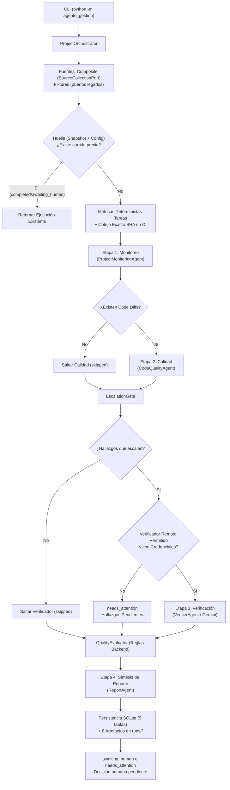

# Arquitectura As-Built del Asistente de Gestión de Proyectos (MVP-01)

Documento técnico de la arquitectura **realmente implementada** en la rama `mvp/real-sources` (código base `fed1ac7d338cf4c4ba2c3e0ac5f20da0c68df1b6`, derivado de `d08bff4`). Refleja el estado as-built del sistema tras cerrar la unidad T7 ([`mvp-01-validation.md`](./mvp-01-validation.md)), delimitando las capacidades verificadas frente a las extensiones pendientes.

## 1. Propósito y Enfoque As-Built

El sistema automatiza la recopilación semanal de avance de proyectos, la auditoría de calidad de código y la recomendación consultiva para gestores humanos. A diferencia de un diseño conceptual distribuido o autónomo, la implementación actual es un **monolito modular síncrono y secuencial**:
- **Monolito Supervisado:** No emplea agentes autónomos descentralizados ni servicios de background no supervisados.
- **Evidencia Objetiva:** El backend suministra hechos del snapshot y valida salidas estructuradas y referencias; esto no garantiza que toda frase libre de un LLM esté libre de inferencias incorrectas.
- **Separación de Responsabilidades:** El cálculo de métricas de tareas y la evaluación de políticas es determinista en el backend; los LLM solo redactan y revisan.
- **Decisión Humana Vinculante:** El sistema genera recomendaciones consultivas; el gestor humano retiene la autoridad final exclusiva.

### Principios Rectores As-Built
1. **Determinismo sobre Heurística:** Métricas como tarjetas terminadas, en progreso, bloqueadas o tasa de avance se calculan mediante funciones puras de Python; los LLMs no calculan porcentajes matemáticos.
2. **Preservación de Evidencias:** Se conservan evidencias y se validan referencias de tarjetas y anclas de código contra datos disponibles; la trazabilidad no constituye una prueba universal de toda afirmación narrativa.
3. **Fallo Seguro (Fail-Safe):** Ante indisponibilidad de fuentes, timeouts o ausencia de credenciales, el sistema no inventa veredictos ni asume estados favorables por defecto.

### Relación con ARCHITECTURA.md
`ARCHITECTURA.md` es la especificación de diseño de referencia; el código actual no está completamente alineado con ella. Este documento registra la línea base construida para continuar desarrollando el MVP existente sin reconstruirlo. No reemplaza ni modifica los documentos de arquitectura anteriores; distingue implementación de validación efectiva.

## 2. Flujo de Datos y Diagrama Lógico

La ejecución la coordina [`ProjectOrchestrator`](../src/agente_gestion/application/orchestrator.py) recibiendo componentes inyectados por inversión de dependencias:



La ruta de fixtures usa los puertos legados de tareas, código, CI y políticas; no implementa `collect_snapshot()`. La selección es explícita, no un respaldo automático de fuentes reales fallidas. Un fallo que aborta una etapa puede terminar la corrida en `failed`, fuera del recorrido exitoso del diagrama.

### Tabla de Etapas de Ejecución

| Etapa | Responsable | Entrada Principal | Salida Producida | Comportamiento ante Fallo |
|---|---|---|---|---|
| `source_collection` | `CompositeSourcesAdapter` | ID de proyecto, corte temporal | `WeeklySnapshot`, `records` | Marca `is_complete=False`; CI omitido si código falla |
| `monitoring` | `ProjectMonitoringAgent` | Tareas, métricas deterministas | `MonitoringDraft` | Aborta corrida temprana con error en etapa |
| `quality` | `CodeQualityAgent` | Diffs de código, políticas | Lista de `CandidateFinding` | Aborta corrida temprana con error en etapa |
| `verifier` | `VerifierAgent` | Hallazgos escalados, reglas | Lista de `FindingVerification` | Marca `needs_attention`; hallazgos quedan pendientes |
| `report` | `ReportAgent` | Borrador, métricas, veredictos | `FinalReport`, `report.md` | Aborta corrida temprana con error en etapa |

## 3. Componentes, Roles y Modelos de Lenguaje

El orquestador utiliza roles internos mapeados a cuatro agentes especializados en [`src/agente_gestion/agents/`](../src/agente_gestion/agents/):

| Rol Interno | Agente Implementado | Modelo por Defecto | Responsabilidad As-Built |
|---|---|---|---|
| `elaborador` | `ProjectMonitoringAgent` | `qwen3.5:2b-q4_K_M` | Redacta borrador narrativo de avance a partir de tarjetas y métricas. |
| `revisor` | `CodeQualityAgent` | `qwen3.5:4b-q4_K_M` | Analiza diffs contra políticas locales e identifica `CandidateFinding`. |
| `verificador` | `VerifierAgent` | `gemini-2.5-flash` | Verifica de forma independiente hallazgos severos o de baja confianza. |
| `aprobador` | `ReportAgent` | `qwen3.5:2b-q4_K_M` | Sintetiza el reporte final respetando la recomendación del backend. |

- **Coordinador y Presupuestos:** [`StageInvocationCoordinator`](../src/agente_gestion/application/generation.py) y `GlobalBudgetTracker` centralizan los intentos LLM. Los valores predeterminados son un reintento transitorio, un intento de reparación y ocho llamadas por corrida; son límites configurables, no presupuestos de solicitudes HTTP a fuentes.
- **Criterios de Escalado ([`EscalationGate`](../src/agente_gestion/application/escalation.py)):** Enruta a verificación independiente hallazgos con severidad `high` o `critical`, categorías sensibles (`inyeccion_sql`, `seguridad`), baja confianza del revisor, señales de contradicción o reglas de calidad obligatorias.
- **Simulación (`--fake`):** Sustituye **exclusivamente** los proveedores LLM por `FakeProvider`. No altera el modo de fuentes externas ni inventa respuestas de red.

## 4. Frontera de Fuentes, Fijación de SHA y Disponibilidad

La recolección de datos la implementa [`CompositeSourcesAdapter`](../src/agente_gestion/adapters/sources/composite.py) vía [`create_composite_source`](../src/agente_gestion/adapters/sources/factory.py):
- **Aislamiento de Red:** Transporte HTTP de solo lectura (`BoundedGetTransport`) con orígenes HTTPS fijos (`api.trello.com`, `api.github.com`), `trust_env=False`, sin redirecciones ni reintentos automáticos de red. Aplica timeouts de inactividad de socket (no plazos wall-clock globales de SO).
- **Adaptador Trello:** Recupera listas y tarjetas en dos GET en la ruta exitosa sin caché; un fallo o una lectura de caché puede producir menos llamadas; valida fechas ISO con zona horaria estricta; detecta contradicciones (`has_contradiction`) si tarjetas completadas tienen etiquetas de bloqueo.
- **Adaptador GitHub:** Parser estricto de parches unificados; extrae líneas de contexto y añadidas al lado `NEW` asociadas a números de línea reales del nuevo archivo (sin numeración falsa continua entre hunks); omite líneas borradas `-`; registra archivos eliminados o diffs binarios/grandes en evidencia normalizada.
- **Sin Fallback Híbrido:** Si falla una fuente en modo real, el sistema **nunca** recurre a fixtures de respaldo. La unidad fallida se registra con su error canónico (`SourceErrorInfo`) y el snapshot queda como `is_complete = False`.
- **Fijación Estricta de Commit SHA:** El commit resuelto en GitHub (`pinned_sha`, 40 o 64 hex) se traslada íntegramente a GitHub Actions. Si el commit tiene 0 archivos modificados (diffs vacíos), el SHA se preserva. Ante fallos de código, el SHA objetivo se omite (`null`) y CI se salta (0 llamadas).
- **Semántica de CI y Disponibilidad:** La API de GitHub Actions no expone conteos de pruebas ni porcentaje de cobertura; se normalizan a `None` (`unknown`). Si el snapshot es incompleto, [`QualityEvaluator`](../src/agente_gestion/quality/evaluator.py) inyecta `Q_SOURCE_AVAILABILITY_INCOMPLETE` en estado desconocido, forzando la recomendación consultiva `evidencia_insuficiente` a menos que exista un fallo mandatorio previo (`solicitar_cambios`).
- **Errores Canónicos Sanitizados:** Errores de transporte se normalizan en categorías estáticas (`configuration`, `network`, `timeout`, `malformed_payload`, `limit_exceeded`), suprimiendo credenciales y trazas crudas de URL.

## 5. Contratos de Dominio y Brecha de ContextBuilder

Los contratos se distribuyen entre [`domain/`](../src/agente_gestion/domain/) y [`ports/`](../src/agente_gestion/ports/), con validación tipada; no todos los modelos son inmutables:
- `GenerationRequest` y `GenerationResult`: Encapsulan el rol del agente, instrucciones, contexto de evidencias y la salida estructurada validada con su duración real.
- `DeterministicTaskMetrics`: Métricas matemáticas de tareas (completadas, pendientes, en progreso, bloqueadas) calculadas honestamente evitando divisiones por cero.
- `WeeklySnapshot`: Agrupa tareas de Trello, diffs de código, corridas de CI y reglas de calidad.
- `CandidateFinding` y `FindingVerification`: Representan hallazgos categorizados y sus veredictos (`confirmed`, `rejected`, `insufficient`).
- `QualityRule` y `PolicyEvaluationResult`: Formalizan las reglas declarativas de calidad de `policies.yaml` y el veredicto consultivo agregado (`recomendar_aprobacion`, `solicitar_cambios`, `evidencia_insuficiente`).
- `SourceExecutionRecord`: Audita cada proveedor con duración medida por `time.perf_counter()` y `attempt_count=1` (unidad de proveedor, no peticiones HTTP).
- **Brecha Arquitectónica As-Built (`ContextBuilder`):** La clase [`ContextBuilder`](../src/agente_gestion/agents/context.py) fue concebida para estimar tokens (`estimate_tokens_from_data`) y acotar contextos por rol (`BoundedContextType`). Sin embargo, **no es invocada** en el flujo actual por el orquestador ni por los agentes. Cada agente construye manualmente su payload de evidencias como listas y diccionarios directos. Existen límites de contenido en adaptadores y validaciones de entrada, pero el flujo no aplica el presupuesto dinámico de tokens de `ContextBuilder`. No debe suponerse una garantía global de tamaño de contexto por agente.

## 6. Persistencia, Auditoría y Seguridad

La persistencia se implementa mediante [`SQLiteStorageAdapter`](../src/agente_gestion/adapters/storage/sqlite.py) y `ArtifactStorageAdapter`:

### Tablas SQLite Implementadas (9 tablas)
| Tabla | Clave Primaria / Índices | Contenido Almacenado |
|---|---|---|
| `runs` | `run_id` (índices en huella y proyecto) | Metadatos de ejecución, estados, duraciones y hashes de huella. |
| `stage_results` | `(run_id, stage_name)` | Estado, duración, hash de salida y resumen por etapa. |
| `snapshots` | `snapshot_id` | JSON completo del snapshot semanal y hash de contenido. |
| `evidence` | `(id, run_id)` | Procedencia y datos normalizados de cada evidencia recolectada. |
| `findings` | `(id, run_id)` | Categoría, archivo, línea, SHA, evidencia, regla, confianza y razones de escalado; sin columna dedicada de severidad. |
| `verifications` | `(finding_id, run_id)` | Veredicto independiente, justificación y evidencias usadas. |
| `llm_calls` | `attempt_id` | Registro detallado de cada intento físico de LLM (tokens, tiempos, errores). |
| `reports` | `report_id` | Reporte final estructurado en JSON y texto Markdown generado. |
| `human_decisions` | `id` | Registro auditable de la decisión humana final, fecha y motivo. |

### Artefactos Generados por Corrida (`runs/<run_id>/`)
- `snapshot.json`: Datos recolectados normalizados (tareas, diffs, CI y reglas).
- `metrics.json`: Métricas deterministas calculadas por el motor de tareas.
- `monitoring.json`: Borrador narrativo generado por el agente elaborador.
- `code_findings.json`: Hallazgos candidatos producidos por el agente revisor.
- `verification.json`: Evaluaciones y veredictos del verificador independiente.
- `report.json`: Estructura serializada del informe final con recomendaciones.
- `report.md`: Informe ejecutivo formateado en Markdown.
- `execution_metrics.json`: Tiempos de etapa, conteo de llamadas LLM y auditoría de fuentes.

### Higiene de Seguridad y Protocolo REST
- **Precedencia de Configuración ([`Settings`](../src/agente_gestion/application/config.py)):** `CLI > Variables de Entorno del SO > Archivo .env > YAML (config.yaml) > Valores por Defecto`.
- **Seguridad y Secretos:** Los campos de credenciales usan `SecretStr`; se rechazan ecos de secretos configurados en SHAs, metadatos y código fuente en los casos cubiertos. Gemini exige `allow_remote_ai=True` y una API key configurada; la autorización puede provenir de CLI, entorno o YAML, no necesariamente de una bandera en cada ejecución.
- **Protocolo REST Gemini ([`GeminiProvider`](../src/agente_gestion/adapters/llm/gemini.py)):** Formatea salidas estructuradas mediante `generationConfig.responseFormat = {"text": {"mimeType": "APPLICATION_JSON", "schema": ...}}`.

## 7. Interfaz CLI y Ejemplos de Invocación

La CLI (`python -m agente_gestion`) expone tres comandos principales:

| Comando | Opciones Principales | Propósito |
|---|---|---|
| `run` | `--sources {fixtures,real}`, `--fixture <NAME>`, `--commit <SHA>`, `--fake`, `--allow-remote-ai` | Ejecuta el flujo E2E completo y persiste la corrida. |
| `source-check` | `{trello,github,github-actions,local-policy,all}`, `--sources {fixtures,real}` | Diagnóstico de solo lectura de conectores sin invocar LLMs. |
| `decide` | `<RUN_ID>`, `--decision {approved,rejected,changes_requested,postponed}`, `--reason <TEXT>` | Registra la decisión humana vinculante en SQLite. |

### Ejemplos de Invocación
```bash
# 1. Ejecución con fixtures offline y LLMs simulados
.venv/bin/python -m agente_gestion run proyecto-demo --fixture fixture_1_standard --fake

# 2. Diagnóstico de solo lectura de fuentes externas configuradas
.venv/bin/python -m agente_gestion source-check all --sources real

# 3. Registro de decisión humana sobre un reporte generado
.venv/bin/python -m agente_gestion decide "$RUN_ID" --decision approved --reason "Aprobado tras revisión manual"
```
Los ejemplos no se ejecutaron para escribir este documento. `RUN_ID` debe contener un identificador existente antes de registrar una decisión humana. Para fijar un commit explícito se puede agregar `--commit "$FULL_COMMIT_SHA"`, con un SHA completo válido ya definido.

*Notas:*
- La combinación simultánea de `--sources real` y `--fixture <NOMBRE>` se rechaza de inmediato con código de salida 2.
- `Settings` normaliza alias de configuración (`github_repo` / `github_repository` y `github_branch` / `github_ref`) en cada capa antes de combinarlas, impidiendo configuraciones contradictorias.

## 8. Límites Verificados y Continuidad del MVP

| Dimensión | Estado As-Built Implementado | Estado de Verificación |
|---|---|---|
| **Suites de Pruebas** | 356 pruebas unitarias e integración en `tests/` | 354 aprobadas, 2 omitidas (`RUN_REAL_LLM_TESTS` opt-in) |
| **Benchmarks** | 7 pruebas deterministas en `pruebas/` | 7 aprobadas localmente |
| **Fuentes Externas (T8)** | Adaptadores Trello, GitHub y Actions implementados | Preflight exit 1 por configuración faltante; 0 GET; ningún endpoint verificado en vivo |
| **E2E real controlado (T9)** | Pipeline y proveedores implementados | No ejecutado por requisitos de fuentes bloqueados; modelos y autenticación real no verificados |

Las cifras de pruebas corresponden a la validación registrada en `mvp-01-validation.md`, no a una nueva ejecución para este documento. Los benchmarks son locales y deterministas, no mediciones de producción. El payload Gemini descrito es el implementado; aquí no se acredita compatibilidad mediante llamadas en vivo.

**Directriz de Continuidad:** Continuar sobre las fronteras de puertos (`ports/`), los contratos validados y la autoridad determinista del backend, preservando la decisión humana final. Esta documentación no inicia una migración ni una reconstrucción.
